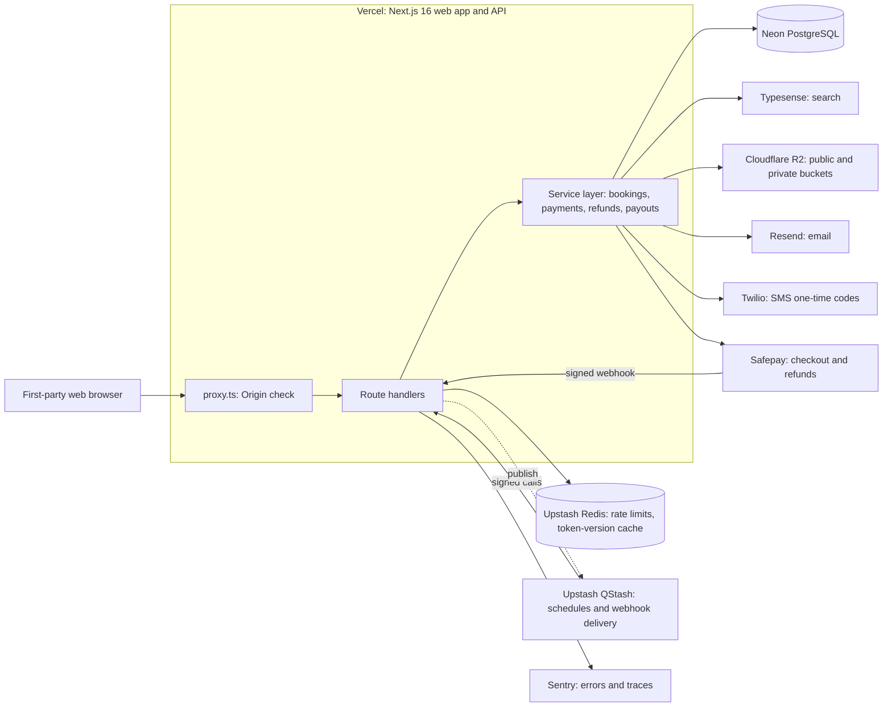
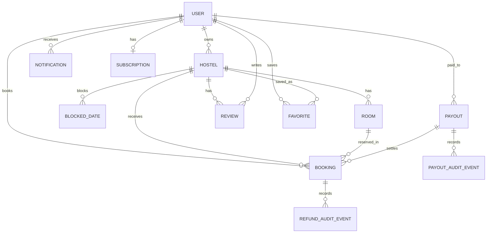
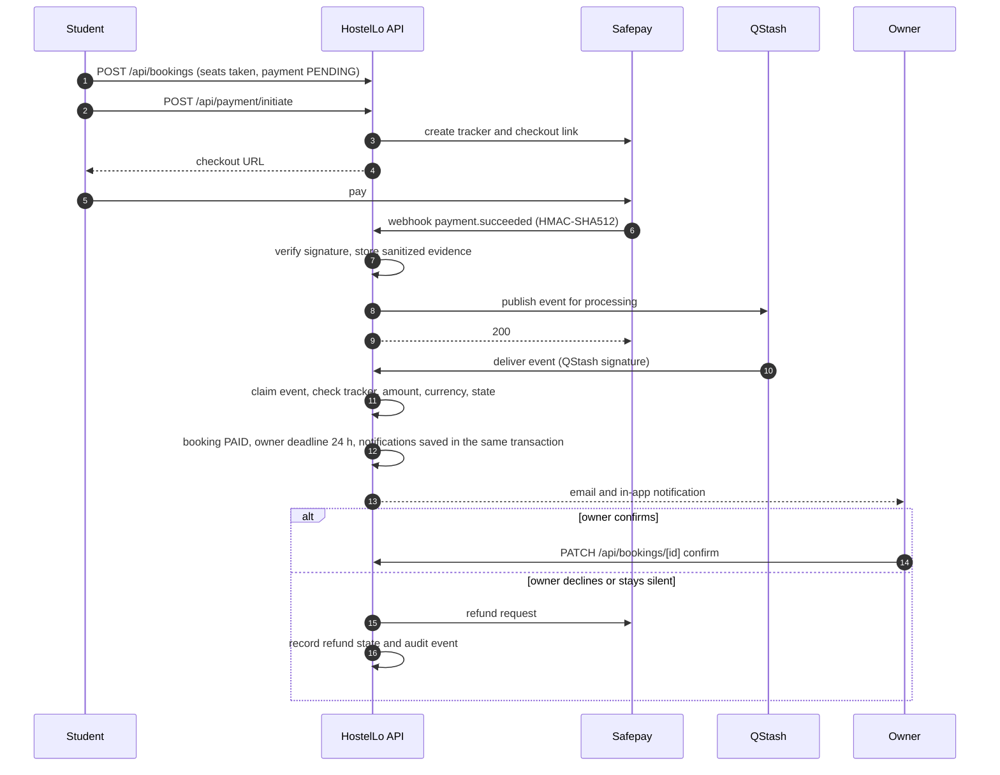
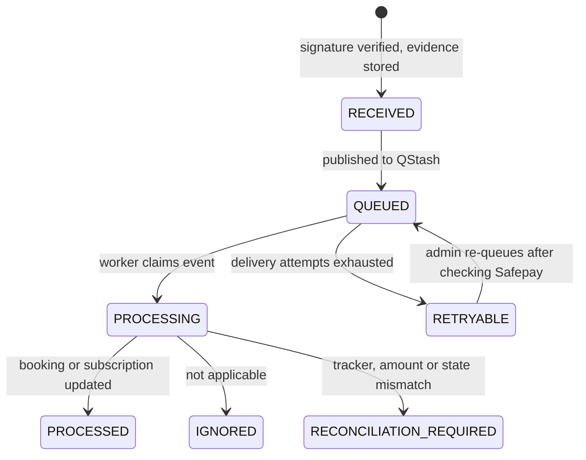
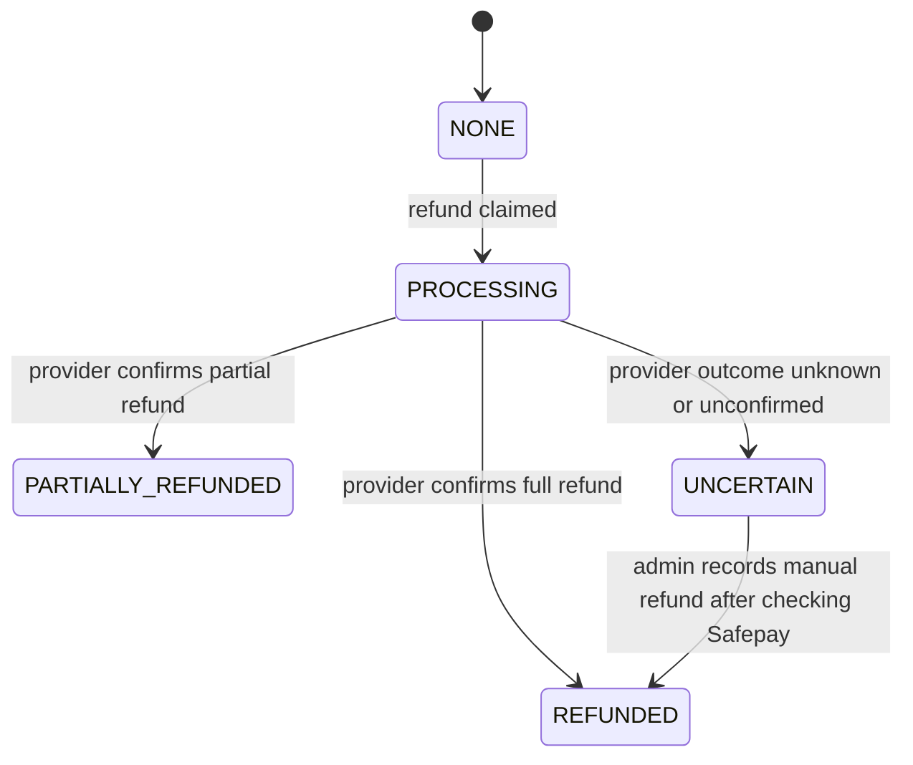
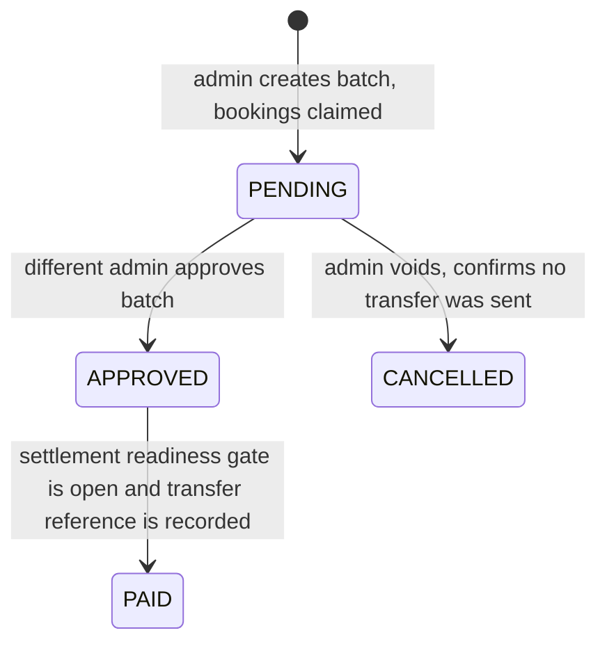
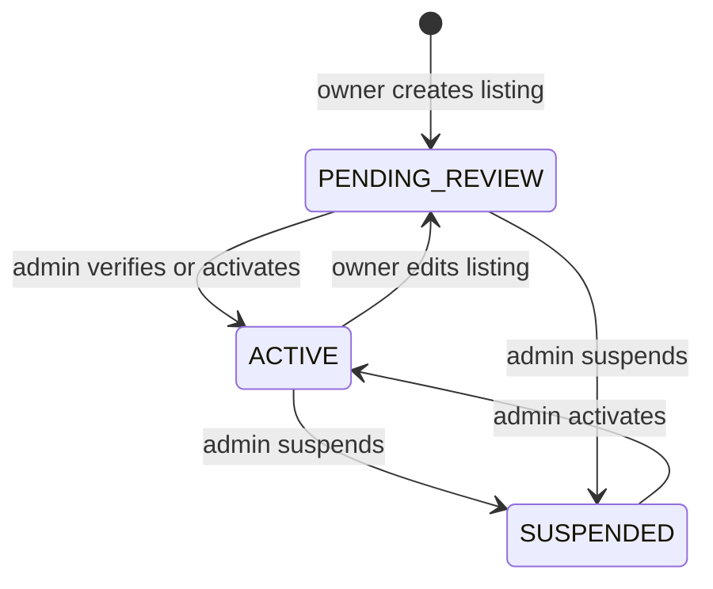

# HostelLo System Design

| | |
|---|---|
| **Version** | 4.5 |
| **Architecture/source review** | November 6, 2026 (repository snapshot and availability alerts; not every system claim was re-audited) |
| **Local verification evidence** | November 9, 2026; current command results are recorded in §14.4 and are not a full-system re-audit |
| **Stage** | Pre-launch. Not cleared for real transaction volume; see the [risk register](#16-risk-register). |
| **Document owner** | _To be assigned_ |

## How to read this document

Statements fall into three kinds, and the document says which:

- **Verified:** checked against the code, with the file named where it helps.
- **Operational:** a property of Neon, Vercel, Upstash, Sentry or another provider console that cannot be verified from source. Marked _(operational)_.
- **Proposed / Decision:** not built yet. Marked **Proposed** or **Decision needed**.

| Document | Contents |
|---|---|
| `SYSTEM.md` (this file) | What the system is, why it is built this way, how its lifecycles work, what is known to be wrong |
| [`CHANGELOG.md`](CHANGELOG.md) | Revision history and archived verification notes |
| [§13 Security](#13-security) and [§16 Risk register](#16-risk-register) | Implemented controls and open security gaps |
| [`docs/team/00-shared.md`](docs/team/00-shared.md) | Shared team instructions and product guardrails |
| [`prisma/MIGRATIONS.md`](prisma/MIGRATIONS.md) | Migration ledger |
| `scripts/check-docs.mjs` | Fails CI when the facts below or the environment-variable list drift from the code |

Source-backed operational guides are now available: [`docs/CI-CD-GUIDE.md`](docs/CI-CD-GUIDE.md), [`docs/OPERATIONS-RUNBOOK.md`](docs/OPERATIONS-RUNBOOK.md), and [`docs/LAUNCH-OPERATIONS-RUNBOOK.md`](docs/LAUNCH-OPERATIONS-RUNBOOK.md). Provider-console settings, alert delivery, and restore procedures remain owner-verified operational checks, not source-verified facts. `docs/PRIVATE-STUDENT-VERIFICATION.md` remains absent (R-20); `DESIGN.md` exists but is historical, not the current design system.

### Repository facts (generated)

Do not edit by hand. Run `node scripts/check-docs.mjs --write` after changing routes, models, migrations, tests or cron jobs.

<!-- docs-check:begin -->
| Fact | Value |
|---|---:|
| Page files (`src/app/**/page.tsx`) | 40 |
| API route handler files | 83 |
| Prisma models | 33 |
| Prisma migrations | 36 |
| Vitest test files | 279 |
| Cron jobs in the schedule registry | 11 |
| Cron route handlers | 11 |
<!-- docs-check:end -->

---

## 1. Purpose and scope

HostelLo is a Pakistan-focused student hostel marketplace. Students search for hostels, book a room and pay online. Owners list hostels and respond to booking requests. Admins moderate listings, verify students, and handle refunds and payouts.

| Actor | What they do |
|---|---|
| Student | Search and compare hostels, check availability, book and pay, cancel, review completed stays, message owners, save favorites, set price and availability alerts, post to the roommate finder |
| Owner | Create and edit listings and rooms, block dates, accept or decline paid booking requests, reply to reviews, message students, view analytics and earnings, buy the Pro plan |
| Admin | Approve or suspend listings, verify student identities, moderate reviews and roommate posts, issue refunds, create payout batches, reconcile payment events, sync the search index |
| System | QStash-triggered cron jobs, Safepay webhooks |

**Current state.** The repository is a Next.js 16 application with API route handlers and first-party student marketplace, owner workspace, admin, messaging, notification, and availability-alert screens. Native mobile support (bearer-token bridge, push notifications, mobile checkout redirects) was retired on October 16, 2026. The implementation is not cleared for live transaction volume: browser-runtime, sandbox, operational recovery, and external deployment gates remain open (R-04, R-06, R-09, R-16).

**Out of scope for the MVP:** separate backend services, international expansion and multi-currency, native mobile apps, offline search, video reviews, Apple Pay and Google Pay until Safepay support is confirmed.

---

## 2. Requirements

### 2.1 Business rules (as implemented)

| Rule | Behavior | Source |
|---|---|---|
| Booking price | `pricePerMonth × months × guests`, whole PKR, computed on the server from the room price. 1 to 4 guests per booking | `booking-service.ts`, shared validations |
| Billable months | Exact whole-calendar-month terms from check-in to check-out; month-end dates clamp to the last day of the target month. The service enforces owner `minStay`/`maxStay` and a global 24-month cap | shared date/validation utilities, `booking-service.ts` |
| Payment hold | A booking with unpaid payment is cancelled and its seats released after 30 minutes; the job runs every 5 minutes | `cron/cancel-abandoned-payments` |
| Owner response window | 24 hours from payment confirmation. If the owner has not confirmed or declined, a job running every 15 minutes cancels the booking and refunds it in full | `cron/expire-unanswered-bookings` |
| Who sees a request | Owner booking lists show paid bookings only; confirm and decline require `PAID` | `bookings` routes |
| Student cancellation | Allowed while `PENDING` or `CONFIRMED` and before check-out. Paid `PENDING` bookings are refunded in full. Paid `CONFIRMED` bookings are refunded under the cancellation policy snapshot. Not allowed once a payout batch has claimed the booking | `bookings/[id]/route.ts` |
| Owner decline, admin cancel | Paid bookings are refunded in full | `bookings/[id]/route.ts` |
| Cancellation policies | See the table below | `cancellation-policy.ts` |
| Listing quota | Free plan: 1 listing. Pro plan: unlimited, PKR 3,000. Enforced in a serializable transaction | `config/plans.ts`, `hostels/route.ts` |
| Listing review | New listings and every owner edit return to `PENDING_REVIEW`; pending listings are removed from the search index | `hostel-service.ts` |
| Listing images | At most 15 per hostel, 4 MB each, JPEG, PNG or WebP, signature-checked | shared config, `upload/route.ts` |
| Reviews | Students only, only for a hostel where they have a `COMPLETED` booking, one per student per hostel, length-limited comment | `reviews/route.ts`, schema |
| Roommate posts | Hidden once three different students report them | roommate routes |
| Availability alerts | HOSTEL and SEARCH alerts match the full `[checkIn, checkOut)` stay and guest count against authoritative seat holds; in-app notifications are emitted once per unmatched-to-matched transition | `availability-alerts.ts`, `room-availability-service.ts` |
| Pagination | Default page size 12, maximum 50, maximum page 10,000 | shared config |
| Payout eligibility | Owner's booking is `CONFIRMED` or `COMPLETED`, `PAID`, check-out has passed, and it is in no payout batch | `payouts.ts` |

Cancellation policies (refund share of the amount paid, by time before check-in):

| Policy | 100% | 50% | 0% |
|---|---|---|---|
| Flexible | 48 hours or more | 24 to 48 hours | under 24 hours, or after check-in |
| Standard | 7 days or more | 72 hours to 7 days | under 72 hours, or after check-in |
| Strict | never | 14 days or more | under 14 days, or after check-in |

Booking terms are whole calendar months (month-end clamped), with a 1-month minimum, 24-month global maximum, and server-enforced hostel `minStay`/`maxStay`. Owner-blocked dates are checked at booking time.

### 2.2 Non-functional requirements

No availability, latency, throughput or recovery targets were defined in the previous document. The values below are **Proposed** starting points for the launch scale. Confirm or replace them, then track them in alerts.

| Area | Proposed target | Why |
|---|---|---|
| API availability | 99.5% monthly for booking, payment and webhook endpoints | Money paths matter more than browse paths |
| Latency (p95, server side) | Search under 500 ms; booking create under 1 s; availability under 300 ms | Mobile networks in Pakistan add 200 to 300 ms of round-trip before the server answers |
| Webhook handling | Acknowledge a Safepay event within 5 s; business changes applied within 60 s of acknowledgement | Matches the store-then-process design in §5.2 |
| Data recovery | RPO 15 minutes or better (Neon point-in-time recovery), RTO 4 hours, restore rehearsed quarterly | Currently only a to-do (R-16) |
| Money integrity | Zero unreconciled payments or refunds older than 24 hours | Gives the reconciliation job a testable goal |
| Delivery of owner notifications | Email within 5 minutes of a paid request | The 24-hour response window runs against the owner |

**Capacity assumptions: needs your input.** Sizing has never been written down. Please fill these in; they decide the database tier, the connection budget and whether caching is needed:

| Question | Launch | 12 months |
|---|---|---|
| Active listings | _ | _ |
| Monthly active students | _ | _ |
| Bookings per day (average, peak week) | _ | _ |
| Peak API requests per second | _ | _ |
| Cities covered | _ | _ |

---
## 3. Architecture

### 3.1 System context



The application is intentionally one deployable unit: route handlers, business logic and schema ship together. There are no separate services.

### 3.2 Technology

| Layer | Implementation |
|---|---|
| Runtime | Next.js 16 App Router on Vercel; first-party pages and API handlers share one application |
| Database | Neon PostgreSQL through Prisma 7 with `@prisma/adapter-pg` (node-postgres) |
| Authentication | Auth.js (NextAuth v5 beta), JWT sessions in HTTP-only cookies; Credentials provider plus optional Google OAuth |
| Search | Typesense, with a Prisma (`ILIKE`) fallback |
| Cache and rate limits | Upstash Redis |
| Scheduling and webhook delivery | Upstash QStash calling signed route handlers |
| Object storage | Cloudflare R2: a public bucket for listing images and a private bucket for student verification documents |
| Email, SMS | Resend, Twilio |
| Payments | Safepay (enabled). JazzCash and EasyPaisa code is present but disabled |
| Observability | Sentry (data minimized) and structured JSON events from `src/lib/operational-logger.ts` with request correlation and HMAC pseudonyms |
| Tests | Vitest; Playwright E2E specs are present, but browser-runtime flows remain unverified |

### 3.3 Request lifecycle

1. **Origin check** (`src/proxy.ts`). In production, a state-changing `/api` request must carry an `Origin` header equal to the configured app URL. Auth.js sign-in, callback and sign-out, cron, and payment webhook/callback routes are exempt. This is not the authorization boundary.
2. **Rate limit.** Upstash sliding window keyed by the Vercel-trusted client IP or by user. If Redis fails in production, most routes fall back to a per-instance in-memory limiter that does not coordinate across instances. Login, OTP, signup, password reset/change and account deletion pass `failClosed: true` and refuse requests instead (`unavailable: true`), so an outage cannot hand an attacker a fresh budget per instance.
3. **Authentication.** `auth()` verifies the JWT and checks `tokenVersion` against a Redis cache (5-minute TTL, database fallback). A stale or malformed token returns no session.
4. **Validation.** The body is streamed through a byte cap, then parsed with Zod. Query strings and path identifiers have length caps.
5. **Service function.** Role and ownership are enforced again in the write predicate. State changes use conditional updates so concurrent requests cannot both win.
6. **Response.** Typed domain errors map to 4xx (stale-state conflicts to 409). Unexpected failures return a generic 500 and log a safe error summary.
7. **Side effects.** In-app notifications are database writes: they are awaited, and for payment events they are written in the same transaction as the state change. Payment-confirmation emails are inserted into the minimal `PaymentEmailOutbox` in that same transaction and drained by QStash. Other emails and search-index updates run after the response through `runAfterResponse` (`src/lib/background.ts`, built on Next's `after()`). Outside a request scope (scripts, tests) the same helper runs the task immediately.

### 3.4 Deployment and environments

- **Toolchain:** Node 26 (`.nvmrc`, and `engines.node` in `package.json`, which Vercel also reads) and npm 12.2.2 or newer. CI and Vercel therefore run the same Node major. The committed lockfile must pass `npm ci`.
- **Pull requests:** CI installs with `npm ci`, then runs the documentation drift check, script tests, type check, Vitest suite and lint, and type-checks the shared package on its own. A Preview is deployed only after those pass.
- **Production:** a push to `main` runs its own gate (the same checks), then the `deploy` job. The job runs in the GitHub Environment `production`, which is where required reviewers are configured, so a deploy can wait for approval. It then creates a Neon branch of the production database (a snapshot, expiring after 14 days by default), applies migrations with `prisma migrate deploy` against Vercel's Production environment, builds, and deploys. The Vercel build never applies migrations.
- **Preview schema changes:** a manually dispatched workflow checks the Preview database host and name against GitHub Environment variables before migrating.
- **Weekly dependency audit:** `audit.yml` blocks on production dependencies and reports development-only findings without failing.
- **Pinned tooling and permissions:** the Vercel CLI is pinned to 65.14.0 for Node 26 support, and every workflow runs with read-only repository permissions unless a job declares more.

GitHub configuration the pipeline reads (set in the `production` environment):

| Name | Kind | Purpose |
|---|---|---|
| `VERCEL_TOKEN`, `VERCEL_ORG_ID`, `VERCEL_PROJECT_ID` | Secrets | Vercel CLI |
| `NEON_API_KEY` | Secret | Creates the pre-migration snapshot branch |
| `NEON_PROJECT_ID`, `NEON_PRODUCTION_BRANCH_ID` | Variables | Which project and branch to snapshot |
| `NEON_SNAPSHOT_REQUIRED` | Variable | Set to `true` to fail the deploy when the snapshot cannot be taken. While unset, the step only warns |
| `NEON_SNAPSHOT_TTL_DAYS` | Variable, optional | Snapshot lifetime in days (default 14) |

Open console steps for this pipeline are listed under R-06.

### 3.5 Configuration

The canonical list is `.env.example` (and `.env.sentry.example`). `scripts/check-docs.mjs` fails when a variable the code reads is missing from those files, or when a variable in them is missing from this table.

| Group | Variables | Checked at startup in production |
|---|---|---|
| Core | `DATABASE_URL`, `AUTH_SECRET`, `AUTH_URL` | Required |
| Legacy alias | `NEXTAUTH_SECRET` | No. Fallback for `AUTH_SECRET` when signing unsubscribe tokens and pseudonymizing log identifiers; remove once `AUTH_SECRET` is confirmed everywhere |
| Preview migrations | `HOSTELLO_MIGRATION_TARGET` | No. Set to `preview` only by the preview-migration workflow; `scripts/migrate-preview.mjs` refuses to run otherwise |
| Public URLs | `NEXT_PUBLIC_APP_URL`, `APP_URL` | No. `AUTH_URL` is the canonical origin (see D-1) |
| Content-Security-Policy rollout | `CSP_ENFORCE` | No. Unset or anything but `true`: the strict nonce policy is only reported. `true`: it is also enforced and every page renders per request. Read at build time; unset and redeploy to roll back |
| Payout encryption | `PAYOUT_DESTINATION_ENCRYPTION_KEY` | Warns in production when missing; payout creation fails with 503 without it |
| Google sign-in (optional) | `AUTH_GOOGLE_ID`, `AUTH_GOOGLE_SECRET` | Optional |
| Storage | `R2_ACCOUNT_ID`, `R2_ACCESS_KEY_ID`, `R2_SECRET_ACCESS_KEY`, `R2_BUCKET_NAME`, `R2_PUBLIC_URL`, `R2_VERIFICATION_BUCKET_NAME`, `R2_VERIFICATION_ACCESS_KEY_ID`, `R2_VERIFICATION_SECRET_ACCESS_KEY` | Required |
| Redis | `UPSTASH_REDIS_REST_URL`, `UPSTASH_REDIS_REST_TOKEN` | Required |
| Safepay | `SAFEPAY_SECRET`, `SAFEPAY_API_KEY`, `SAFEPAY_WEBHOOK_SECRET` | Required |
| Safepay environment | `NEXT_PUBLIC_SAFEPAY_ENV` | Required in production, and must be `production` or `sandbox`. `sandbox` is allowed but logged as a warning |
| Safepay (rotation) | `SAFEPAY_WEBHOOK_SECRET_PREVIOUS`, `SAFEPAY_WEBHOOK_SECRET_PREVIOUS_UNTIL` (overlap of at most 72 hours) | Optional |
| JazzCash, EasyPaisa (disabled) | `JAZZCASH_MERCHANT_ID`, `JAZZCASH_PASSWORD`, `JAZZCASH_INTEGRITY_SALT`, `JAZZCASH_ENV`, `EASYPAISA_STORE_ID`, `EASYPAISA_HASH_KEY`, `EASYPAISA_ENV`, `GATEWAY_IPS` | Optional |
| Email | `RESEND_API_KEY`, `EMAIL_FROM` | Required. `RESEND_API_KEY` must start with `re_` and must not be the placeholder |
| Email (support address) | `SUPPORT_EMAIL` | No |
| SMS | `TWILIO_ACCOUNT_SID`, `TWILIO_AUTH_TOKEN`, `TWILIO_PHONE_NUMBER` | Warns in production when missing; phone verification fails closed without them |
| Search | `TYPESENSE_HOST`, `TYPESENSE_PORT`, `TYPESENSE_PROTOCOL`, `TYPESENSE_API_KEY` | Optional; without them search uses the database |
| Jobs | `CRON_SECRET`, `QSTASH_TOKEN`, `QSTASH_CURRENT_SIGNING_KEY`, `QSTASH_NEXT_SIGNING_KEY` | Required |
| Jobs (optional) | `QSTASH_URL` | Optional regional endpoint |
| Observability | `SENTRY_DSN`, `NEXT_PUBLIC_SENTRY_DSN`, `SENTRY_ORG`, `SENTRY_PROJECT`, `SENTRY_AUTH_TOKEN` | Optional |
| Seeding (local only, never production) | `SEED_ADMIN_EMAIL`, `SEED_ADMIN_PASSWORD`, `SEED_OWNER_PASSWORD`, `SEED_STUDENT_PASSWORD`, `SEED_OWNER_1_EMAIL`, `SEED_OWNER_2_EMAIL`, `SEED_OWNER_3_EMAIL`, `SEED_OWNER_4_EMAIL`, `SEED_STUDENT_EMAIL` | n/a |

### 3.6 Client topology

**Decision needed (D-1).** The backend assumes a first-party, same-origin browser client: cookie sessions, and an `Origin` check that must equal the API's own configured URL. There is no CORS handling, so a separately hosted web app, a mobile app or a plain API client is rejected in production. One variable (`AUTH_URL`) also serves as email-link base, payment-redirect base, Auth.js base and QStash callback target. See D-1 in §15 for options.

---

## 4. Domain model

The schema is `prisma/schema.prisma`.

### 4.1 Entity relationships



### 4.2 Models (33)

| Area | Models |
|---|---|
| Identity and auth | `User`, `Account`, `Session`, `VerificationToken`, `PasswordResetToken`, `PhoneVerificationToken`, `AccountDeletionJob` |
| Listings and community | `Hostel`, `Room`, `BlockedDate`, `HostelVerificationReview`, `Review`, `Favorite`, `PriceAlert`, `AvailabilityAlert`, `HostResponseSummary`, `RoommatePost`, `RoommateReport` |
| Bookings and money | `Booking`, `SeatHold`, `LatePaymentResolution`, `RefundAuditEvent`, `SafepayWebhookEvent`, `SafepayWebhookReplayEvent`, `Payout`, `PayoutAuditEvent`, `Subscription`, `PaymentEmailOutbox` |
| Messaging and notifications | `Conversation`, `ConversationParticipant`, `Message`, `Notification` |
| Operations | `CronLog` |

Money is stored as integer PKR and converted to paisas only at the Safepay boundary. Review counts and ratings are denormalized on `Hostel` and maintained transactionally, with repair scripts available. `Account`, `Session` and `VerificationToken` are Auth.js adapter tables; sessions use JWTs, so `Session` rows are not the source of truth.

`Room.available` and its optimistic-lock `version` remain legacy fields; date-bounded `SeatHold` rows are the booking inventory authority. The legacy counter is no longer used for booking availability (R-01).

### 4.3 Invariants and where they are enforced

| Invariant | Enforced by | Gap |
|---|---|---|
| One Safepay tracker maps to one booking | Database unique constraint on `Booking.transactionId` | |
| Webhook delivery is idempotent | Unique body hash on `SafepayWebhookEvent` | |
| Late-payment outcomes are traceable | Unique source webhook and tracker on immutable `LatePaymentResolution` rows | |
| One review per student per hostel | Database unique constraint | |
| Payout audit events cannot change | Database triggers reject update, delete and truncate; CHECK constraints on the table | |
| APPROVED payout has a timestamp and different creator/approver | PostgreSQL CHECK plus transactional conditional update | Admin identity/session assurance remains limited (R-10) |
| A booking joins at most one payout and cannot be cancelled after a batch claims it | Conditional updates with `payoutId: null` in the write predicate | Application only |
| Owner plan quota | Serializable transaction with bounded retry | Application only |
| Seats never negative or above capacity | Optimistic lock and a post-update check | **No CHECK constraint**; counter is also never restored on stay completion (R-01) |
| Check-out after check-in, amounts non-negative, refunded amount at most total | Zod validation | **No CHECK constraints** (R-12) |
| Status-like values | Prisma enums for booking, payment, refund, payout, listing and webhook-event status | `paymentMethod`, `AccountDeletionJob.status` and `phase`, `CronLog.status` are free strings (R-12) |
| `Hostel.rooms` and `capacity` match its `Room` rows | Application | Denormalized; can drift (R-12) |

### 4.4 Data classification and retention

| Class | Examples | Where it lives | Protection | Retention |
|---|---|---|---|---|
| Public listing data | Hostel name, location, prices, amenities, ratings, images | Postgres, Typesense, R2 public bucket | Active listings only are returned publicly; image URLs allow-listed | While listed |
| Account identity | Name, email, phone, role | Postgres `User` | Auth required; never in logs (pseudonymized) | Until account deletion |
| Credentials | Password hash (bcrypt, cost 12, 72-byte cap), reset and verification tokens (SHA-256 digests), phone one-time codes (stored in plaintext, 10-minute expiry, 5 attempts) | Postgres | Short-lived, single-use; expired tokens removed daily | Short |
| Financial | Booking amounts, Safepay tracker IDs, late-payment, refund and payout records | Postgres | Immutable late-payment and refund audit records; payout destination snapshots encrypted with AES-256-GCM | Kept after account deletion with the account anonymized |
| Owner bank details | Account title, number, bank name | Postgres `User` (plaintext) and `Payout` (encrypted snapshot) | Admin-only reads; snapshot encrypted, the source columns are not (R-12) | Until the owner edits or deletes them |
| Student identity documents | ID image for student verification | Private R2 bucket | Separate bucket and token; copy-on-submit to immutable keys; admins stream through an authenticated no-store route | Abandoned uploads removed hourly; **retention after review is undefined** |
| Messages and reviews | Conversation text, review text | Postgres | Participant-only reads | Deleted with the account |
| Payment email delivery metadata | Recipient user ID, booking ID, typed template, idempotency key and retry state | Postgres `PaymentEmailOutbox` | No email address, subject, body, provider response or raw error is persisted | Pending/retry records expire within 30 days of enqueue; sent records 24 hours after delivery; terminal failures 30 days after final attempt; QStash cleanup must run |
| Operational logs | Structured events, Sentry events | Vercel and Sentry _(operational)_ | Allow-listed fields, HMAC pseudonyms, SDK payload collection disabled | Provider defaults; **set explicitly** |

**D-6 status:** the payment-confirmation outbox uses the minimal metadata and expiry windows above. Retention for student documents, rejected verification records, messages and logs, and encryption of owner bank details on `User`, remain open. The email outbox does not include signup, password-reset, price-alert or other email flows.

---
## 5. Lifecycles and state machines

### 5.1 Booking

```mermaid
stateDiagram-v2
  [*] --> PENDING: student creates booking, seats taken
  PENDING --> CONFIRMED: owner confirms, payment is PAID
  PENDING --> CANCELLED: owner declines, refund
  PENDING --> CANCELLED: owner silent for 24 h, refund
  PENDING --> CANCELLED: unpaid after 30 min
  PENDING --> CANCELLED: student cancels
  CONFIRMED --> CANCELLED: student or admin cancels, policy refund
  CONFIRMED --> COMPLETED: check-out passed, daily job
  CANCELLED --> PENDING: late payment; full stay atomically reacquired
  CANCELLED --> [*]
  COMPLETED --> [*]
```



Every transition is a conditional update that names the state it expects, so two concurrent actions cannot both succeed. Notifications and emails follow the transition.

| Transition | Seat holds released? |
|---|---|
| Owner declines | Yes |
| Owner silent for 24 hours (cron) | Yes |
| Unpaid after 30 minutes (cron) | Yes |
| Student or admin cancels | Only if check-in is still in the future |
| Stay completes (cron) | **No**; the stay's date range expires naturally |

### 5.2 Payment and webhook

Payment status is `PENDING`, `PAID`, `FAILED`, `PARTIALLY_REFUNDED` or `REFUNDED`. A failed payment can be retried; a retry creates a new Safepay tracker. A successful payment after cancellation is recorded as a late-payment resolution: the booking is reinstated only if all required seats can be acquired for the full stay in the same transaction; otherwise the booking remains cancelled and a full refund is requested through the audited refund flow. Provider uncertainty remains in the existing health and admin reconciliation paths.

Code layout of `/api/payment/webhook`: `src/lib/safepay-webhook-auth.ts` is the authentication boundary for both kinds of request (Safepay's HMAC-signed event, with a body-size bound, signature over the raw bytes, then the merchant key; and QStash's own queued delivery, signature-verified, never the shared cron secret). It touches no database. `route.ts` holds the inbox, claim and payment-state handlers and only runs after authentication succeeds.



The webhook endpoint serves two callers on one URL. Safepay's request is verified by HMAC and stored (ingress). QStash's request carries an Upstash signature and applies the business change (worker).

Webhook event states:



A claim that has been `PROCESSING` for more than five minutes is treated as stale and can be reclaimed. `RECONCILIATION_REQUIRED` events are never replayed automatically; an admin resolves them in Safepay. Re-queues are recorded in `SafepayWebhookReplayEvent`. Late-payment resolutions and refund audit events are append-only in the database.

### 5.3 Refund



Automatic refunds start from owner decline, owner timeout, student cancellation of a paid booking, and late payment when the full stay cannot be reacquired. An admin can also trigger a refund for a cancelled, paid booking through `PATCH /api/admin/bookings/[id]/refund`. A full refund counts as confirmed only when Safepay returns the tracker state `TRACKER_REFUNDED`. Each attempt, provider outcome and manual confirmation is an append-only `RefundAuditEvent`. The `sweep-cancelled-refunds` job retries eligible cancelled/paid bookings through the same compare-and-set claim; `PROCESSING` and `UNCERTAIN` refunds remain in the existing reconciliation flow.

### 5.4 Payout



Batch creation claims eligible bookings with a conditional update, computes the amount with a database aggregate, and stores an AES-256-GCM encrypted snapshot of the owner's bank destination. A different admin must approve the batch; creation and approval are recorded in append-only `PayoutAuditEvent` rows. The transfer itself remains outside the product. The repository readiness gate is fail-closed, so an approved batch must not be transferred or marked paid until custody and independent settlement reconciliation are approved. Marking paid is operator evidence, not provider-confirmed settlement.

### 5.5 Listing



`DRAFT` exists in the enum but no API path creates it. Verifying a listing (the verified badge) requires the admin to confirm location, listing details and photos. Suspended listings cannot be edited by the owner and are hidden from public reads, alerts and favorites. Only `ACTIVE` listings appear in search; the database re-checks status when hydrating Typesense hits.

### 5.6 Student verification

`NONE` to `PENDING` when a student submits a document, then `APPROVED` or `REJECTED` by an admin. Only applications still `PENDING` can be decided; a stale decision returns a conflict.

### 5.7 Account deletion

A deletion request creates an `AccountDeletionJob`. A worker running every minute advances it through resumable, keyset-batched phases: notifications, messages, participants, favorites, price alerts, roommate reports and posts, reviews, reset and phone tokens, sessions, linked accounts, bookings, hostels, the private verification document, then anonymization of bookings and payouts, and finalization. Completed financial history is kept with the account anonymized. Deletion is blocked while stays, refunds, payouts or plan payments need attention.

---

## 6. API surface

All endpoints live under `/api`. Responses generally use `{ "data": {}, "message": "...", "error": "..." }`, but list endpoints add their own pagination fields and errors often carry only `error`; there is no error-code catalogue and no OpenAPI document (R-09).

**Access levels:** _Public_ (rate limited), _Signed in_ (any role), _Student_, _Owner_, _Admin_, _Participant_ (party to the conversation), _HMAC_ (provider signature), _QStash_ (Upstash signature, or `CRON_SECRET` bearer).

| Area | Endpoints | Access |
|---|---|---|
| Sign-up and sign-in | `/api/auth/signup`, `/api/auth/[...nextauth]` (Auth.js: credentials, Google, session, sign-out), `/api/auth/email-otp` (request a sign-in code), `/api/auth/email-otp/verify` (verify the code) | Public |
| Email verification and password reset | `/api/auth/verify-email` (GET renders a confirmation form, POST consumes the token), `/api/auth/forgot-password`, `/api/auth/reset-password` | Public |
| | `/api/auth/resend-verification` | Signed in |
| Phone verification | `/api/auth/phone/request-otp`, `/api/auth/phone/verify-otp` | Signed in |
| Account | `/api/auth/delete-account` (not for admins), `/api/profile`, `/api/profile/change-password` | Signed in |
| Student verification | `/api/user/verify-student`, `/api/user/verify-student/upload` | Student |
| Hostels | `/api/hostels` (GET search is public; POST creates a listing as Owner), `/api/hostels/nearby` (POST nearby search; 25 km radius), `/api/hostels/mine` | Public / Owner |
| | `/api/hostels/[param]` (GET returns owner contact details, Admin; PATCH edits the listing, Owner) | Admin / Owner |
| | `/api/hostels/[param]/public` (public-safe detail projection) | Public |
| | `/api/hostels/[param]/availability` (informational 12-month calendar), `/api/hostels/[param]/availability/exact` (room seats for a requested stay), `/api/hostels/[param]/view` (view counter) | Public |
| | `/api/hostels/[param]/favorite`, `/api/hostels/[param]/roommates` | Student |
| | `/api/favorites` | Signed in |
| Roommates | `/api/roommates/[id]` (author deletes own post), `/api/roommates/[id]/report` (Student) | Signed in / Student |
| Bookings | `/api/bookings`, `/api/bookings/[id]` (student, owner or admin, each scoped to their own records) | Signed in |
| Payments | `/api/payment/initiate` (the booking's student) | Signed in |
| | `/api/payment/webhook` (Safepay ingress and QStash worker), `/api/payment/webhook/failure` (QStash failure callback) | HMAC / QStash |
| | `/api/payment/callback` (gateway return; JazzCash and EasyPaisa disabled) | Gateway |
| Reviews | `/api/reviews` (GET public per hostel, or all for admins; POST Student), `/api/reviews/mine` | Mixed / Owner |
| | `/api/reviews/[id]` (delete, Admin), `/api/reviews/[id]/reply` (Owner or Admin) | Admin / Owner |
| Messaging | `/api/conversations` (start with an active hostel, Student), `/api/conversations/[id]` | Participant |
| Notifications | `/api/notifications`, `/api/notifications/[id]` | Signed in |
| Price alerts and email preferences | `/api/price-alerts`, `/api/price-alerts/[id]` (Signed in); `/api/alerts/unsubscribe`, `/api/email/unsubscribe` (signed token) | Signed in / Public |
| Availability alerts | `/api/availability-alerts` (paginated list and create), `/api/availability-alerts/[id]` (edit, pause/resume, delete) | Student |
| Owner tools | `/api/owner/analytics`, `/api/owner/earnings` (earnings and bank details), `/api/owner/hostels/[id]/blocked-dates`, `/api/owner/subscription` | Owner |
| Admin: listings and search | `/api/admin/listings`, `/api/admin/listings/stats`, `/api/admin/hostels` (verify, activate, suspend), `/api/admin/search/sync` | Admin |
| Admin: people and community | `/api/admin/verifications`, `/api/admin/verifications/analytics`, `/api/admin/verifications/[userId]/document`, `/api/admin/roommate-reports`, `/api/admin/roommate-reports/[postId]` | Admin |
| Admin: money | `/api/admin/bookings/[id]/refund`, `/api/admin/payouts`, `/api/admin/payouts/[id]`, `/api/admin/payment-events`, `/api/admin/payment-events/[id]/retry` | Admin |
| Uploads | `/api/upload` (listing images; Owner or Admin with or without `hostelId`; per-user limit of 20 uploads per 10 minutes, R-11) | Owner / Admin |
| Support | `/api/contact`, `/api/report` | Signed in |
| Health | `/api/health/crons`, `/api/health/payments` | Admin or internal `x-cron-health-secret` |
| Security reports | `/api/csp-report` (browser Content-Security-Policy violation reports; logs sanitized summaries only, always 204, 20 per minute per IP, exempt from the CSRF Origin check because browsers send no Origin) | Public |
| Jobs | `/api/cron/cancel-abandoned-payments`, `/api/cron/drain-payment-email-outbox`, `/api/cron/check-price-alerts`, `/api/cron/cleanup-tokens`, `/api/cron/cleanup-verification-uploads`, `/api/cron/expire-availability-alerts`, `/api/cron/expire-pro-subscriptions`, `/api/cron/expire-unanswered-bookings`, `/api/cron/mark-completed-stays`, `/api/cron/process-account-deletions`, `/api/cron/sweep-cancelled-refunds` | QStash |

---

## 7. Authentication and authorization

**Sign-in.** Email and password through the Auth.js Credentials provider, plus optional Google OAuth (Prisma adapter; creates a student account with a verified email). Passwords use bcrypt cost 12 and are limited to 72 UTF-8 bytes so bcrypt never silently truncates them.

**Sessions.** JWT in an HTTP-only cookie. The JWT callback checks `tokenVersion` on every session read, against a Redis cache with a 5-minute TTL and a database fallback. A stale or malformed token yields no session. Password change and reset increment `tokenVersion`; any role change must do the same and invalidate the cache entry. No explicit session lifetime is configured, so the Auth.js default (30 days) applies.

**Sign-in throttling.** Two independent buckets: 10 attempts per 15 minutes per trusted client IP, and 5 per 15 minutes per account-and-IP pair (keyed by HMAC), preventing a remote client from locking out an account across all IPs. Unknown accounts perform a bcrypt cost-12 check and invalid credentials share a generic rejection (R-10).

**Verification.**

- Email: a hashed single-use token. The link's GET only renders a confirmation form; a same-origin POST consumes it, so mail scanners cannot.
- Phone: six-digit code, 10-minute expiry, five attempts, consumed atomically with the change it authorizes.
- Email, phone and student verification are recorded on the user but **no endpoint requires them** (D-5).

**Roles and ownership.**

| Role | Scope |
|---|---|
| Student | Own bookings, reviews, favorites, alerts, messages, profile; roommate posts and reports; student verification |
| Owner | Own hostels and their bookings, messages, reviews, blocked dates, earnings and bank details, subscription |
| Admin | Listing moderation, student verification, review and roommate moderation, refunds, payout batches, payment-event reconciliation, search sync |

Authorization happens at the data boundary, not in the proxy. Handlers check the role, then put the user's ID or the owner relation into the database write predicate, and answer 404 for both absent and foreign records. A stale owner edit therefore cannot undo an admin suspension.

**Origin check.** See §3.3 and D-1.

**Gaps.** There is no admin API to list, suspend or change the role of a user, no multi-factor authentication for admins, and no second approver for refunds; payout batches now require a different admin to approve (R-10).

---

## 8. Money movement

### 8.1 Safepay checkout and settlement

- `POST /api/payment/initiate` creates a Safepay v3 tracker and a hosted checkout link. The tracker is stored in `Booking.transactionId`; a retry while the payment is pending reuses it. Amounts are whole PKR in the database and paisas at the Safepay boundary.
- The webhook is the source of truth. It accepts `payment.succeeded` and `payment.failed`, verifies HMAC-SHA512 over the raw body and the merchant key, and during key rotation accepts a configured previous secret until an expiry of at most 72 hours.
- Ingress stores sanitized evidence (the merchant key is redacted; a body hash makes redelivery idempotent) and publishes to QStash. The worker checks order, tracker, provider, terminal state (`TRACKER_ENDED` for success), currency and exact amount, then applies a conditional booking transition.
- Conditional updates bind provider and tracker, so duplicates cannot settle twice and a delayed success cannot revive a cancelled booking without the late-payment policy.
- A late success is stored in immutable `LatePaymentResolution` evidence. The system atomically reacquires the full stay and reinstates the booking when possible; otherwise it keeps the booking cancelled and requests a full audited refund. Conflicting or invalid provider evidence remains in the admin and health reconciliation paths.
- `sweep-cancelled-refunds` retries eligible cancelled/paid positive-refund records after a crash between the booking transition and refund dispatch.
- Checkout requests to Safepay time out after 10 seconds and refund requests after 15. A timeout surfaces as a failed payment setup, and the student can retry.

### 8.2 Refunds

See §5.3. Operators verify provider state before recording a manual refund. Sandbox validation of the refund call is still open (R-04).

### 8.3 Payouts

Admins create a manual batch per owner from eligible bookings (§2.1). One shared predicate defines eligibility for the owner's pending balance, the admin queue and the transactional claim. Batch creation re-checks the OWNER role and requires a complete bank destination. Marking a batch paid requires a transfer reference, which is operator evidence, not provider settlement. Pending batches can be voided with a reason and explicit confirmation that no transfer was sent. An approved batch cannot currently be voided or release its booking claims; do not create or approve operational batches until a safe recovery path is implemented and tested.

The repository default is platform-held funds and independent dual control: a different admin must approve each payout batch. Eligible bookings require `checkOut` to have passed. The transfer remains off-platform/manual and the app's settlement readiness is fail-closed; no amount may be marked paid until custody, accounting and independent reconciliation are approved. Payout timing/fees/cancellation treatment and qualified advice remain open. Batch creation claims bookings, and approved batches have no recovery/void path; do not create or approve operational batches until that gap is closed.

### 8.4 Owner subscription

Pro costs PKR 3,000 through an explicit Safepay checkout. A successful payment grants one clamped UTC calendar month plus a seven-day entitlement grace window. Date-aware checks and a daily expiry sweep downgrade owners after grace. Owners can explicitly renew during an active term or grace window; a renewal extends from the recorded term end before grace cutoff, or starts at callback receipt time after grace. Automatic charges are not implemented. Failed checkout references can be retried; stale successful trackers require reconciliation (R-19).

### 8.5 What is not modeled

No double-entry ledger, no fee or commission accounting (payout equals the gross booking total, and Safepay's processing fee is not recorded), no payout reversal, and no reconciliation of Safepay settlements against HostelLo's records. Revenue today is the Pro subscription only. These need an approved accounting model before real volume (R-05).

### 8.6 JazzCash and EasyPaisa

Both are disabled. The callback route still ships: JazzCash callbacks fail closed without an integrity salt, compare the HMAC in constant time and optionally enforce a gateway IP allow-list; EasyPaisa redirects are unsigned and cannot settle a booking. Before enabling either, bind the provider reference to the selected booking to prevent cross-booking replay, or delete the code (R-18).

---
## 9. Background jobs

Eleven jobs run on QStash schedules. The schedule, endpoint and health-freshness threshold are defined once in `src/lib/cron-schedules.ts`, which both the registration script (`npm run schedule-cron`) and the health endpoint read.

| Job | Schedule (UTC) | What it does | Alert if older than |
|---|---|---|---|
| `cancel-abandoned-payments` | every 5 minutes | Cancels bookings whose payment has been pending more than 30 minutes and returns their seats | 10 minutes |
| `sweep-cancelled-refunds` | every 5 minutes | Retries eligible positive refunds for cancelled paid bookings through the existing refund claim | 10 minutes |
| `expire-unanswered-bookings` | every 15 minutes | Reminds owners before the deadline; cancels and refunds paid bookings the owner has not answered within 24 hours | 30 minutes |
| `check-price-alerts` | every 6 hours | Emails users when an active hostel's price drops to their target | 8 hours |
| `expire-availability-alerts` | every 5 minutes | Expires active date-bound alerts when their check-in date begins | 10 minutes |
| `cleanup-tokens` | daily at 01:00 | Deletes expired password-reset, verification and phone tokens | 26 hours |
| `cleanup-verification-uploads` | hourly | Deletes abandoned temporary uploads (1 hour) from the private verification bucket; sweeps stored documents that no account references (older than 24 hours; aborts if most of the bucket looks unreferenced, e.g. wrong database); expires pending requests unreviewed for 60 days (deletes the document, resets the student to not submitted, notifies them). Steps run independently; any failure fails the run | 2 hours |
| `expire-pro-subscriptions` | daily at 02:00 | Downgrades owners after the monthly Pro term and seven-day grace window | 26 hours |
| `drain-payment-email-outbox` | every minute | Retries transactional booking-payment confirmation emails and expires retained rows | 3 minutes |
| `mark-completed-stays` | daily at 00:00 | Moves `CONFIRMED` and `PAID` bookings past check-out to `COMPLETED`; completion notifications are written in the same transaction | 26 hours |
| `process-account-deletions` | every minute | Advances resumable account-deletion jobs (§5.7) | 3 minutes |

**Security.** `verifyUpstashRequest` validates the QStash JWT (signature, endpoint URL, body hash) with the official receiver, using the current and next signing keys so keys can rotate. A `CRON_SECRET` bearer token is also accepted for manual runs and legacy schedulers.

**Semantics.** Jobs process batches of 100 and use conditional updates, so a repeated run is safe. Each run writes a `CronLog` row before responding, and `GET /api/health/crons` reports freshness against the thresholds above. Payment-confirmation email delivery has a minimal reference-only outbox; signup/reset and price-alert email remain best effort. In the price-alert job a crash between the email provider accepting a message and the database recording it can send a duplicate (R-07).

Helper scripts: `scripts/schedule-cron-jobs.ts`, `scripts/check-price-alerts.ts`, `scripts/setup-typesense.ts`, `scripts/verify-typesense-fallback.ts`.

---

## 10. Notifications and messaging

| Channel | Provider | Used for |
|---|---|---|
| In-app | `Notification` table, read through `/api/notifications` | Booking requested, confirmed, cancelled, completed, refunded; message received; review received; listing approved or rejected; student verification decided; price and availability alerts |
| Email | Resend | Verification and welcome, password reset, booking lifecycle, refunds, price alerts, admin moderation, support and report mail. Price-alert and global preferences can be changed through signed unsubscribe links |
| SMS | Twilio | Phone verification codes only. Without credentials the code is logged in development |

**Delivery guarantees.**

- **In-app notifications** are database rows. They are awaited, and for payment events (booking paid, Pro activated) they are written in the same transaction as the state change, so they exist if and only if the change was applied. If that transaction fails, the booking stays unpaid and QStash retries the event.
- Availability alerts are student-only, date-range-aware `HOSTEL` or `SEARCH` rules. They use the room seat-hold availability authority, re-evaluate after inventory and listing transitions, and atomically record the match transition with one English in-app notification. Each notification links only to the student's alert manager; criteria and dates can be edited, alerts paused/resumed, and expired alerts deleted or replaced.
- **Emails:** payment-confirmation messages are transactionally queued to `PaymentEmailOutbox` and retried by QStash with reference-only retention; other email flows still use `runAfterResponse` and are best effort (R-07).
- The Safepay worker awaits its two emails before acknowledging; the completion job writes its notifications transactionally.
- In production, `sendEmail` returns a failure, and logs an error, when the Resend key is missing or a placeholder. Startup validation also rejects a malformed key (R-14).

**Messaging.** A student starts a conversation with an owner about an active hostel. Reads and writes are limited to participants (admins are not participants), paginated, and rate limited per user.

---

## 11. Search

`GET /api/hostels` searches Typesense when it is configured and healthy, and falls back to Prisma otherwise.

- **Filters:** text query, city, gender, price range, amenities, verified flag. **Sort:** newest, price ascending or descending, rating. Page size defaults to 12, maximum 50.
- **Nearby search:** `POST /api/hostels/nearby` accepts coordinates and optionally a move-in date and guest count; it returns hostels within 25 km and can filter by availability for the selected date.
- **Index sync:** a listing is indexed when it becomes `ACTIVE`, re-indexed on change, and removed while it is pending review. Suspended listings are excluded by the database re-check below. `POST /api/admin/search/sync` runs a full reindex in 100-row keyset pages, limited to two per hour.
- **Safety net:** Typesense results are re-read from Postgres and kept only if the hostel is still `ACTIVE`, so a stale index cannot expose an unpublished listing.
- **Degraded mode:** the response says when the database fallback served it. An empty Typesense result also triggers the fallback so newly approved or seeded rows stay discoverable.

Known problems (R-13): `city` and amenity values are interpolated into Typesense `filter_by` without quoting or escaping; every zero-hit query runs `ILIKE` scans over five columns with no trigram index; and there is no university search despite hostels having coordinates and the shared package carrying a university list. Nearby search is available, but students still cannot search by campus. For a student marketplace, "near my campus" is the primary query, so treat this as a product gap and not only a technical one.

`GET /api/hostels/[param]/availability` returns an informational 12-month hostel-wide calendar. `GET /api/hostels/[param]/availability/exact` requires `checkIn`, `checkOut`, and `guests`, then returns per-room capacity, seats available across the full half-open stay, and fit status from seat holds. Booking writes use the same seat-hold authority. Owner blocks are inclusive and cannot overlap active holds; the monthly aggregate is not a booking decision.

---

## 12. Storage and uploads

| Bucket | Content | Rules |
|---|---|---|
| Public listing bucket | Hostel and room images | Up to 15 images per hostel, 4 MB each, JPEG, PNG or WebP, content signature checked. Public images are decoded, auto-oriented and re-encoded before storage to remove source metadata; decode is capped at 20 million pixels. Submitted image URLs must match the configured public base URL. Objects are served with immutable long-lived cache headers |
| Private verification bucket | Student ID documents | Student-only upload through the app, 4 MiB cap, metadata and signature checks, copied on submit to immutable review keys. Admins read through an authenticated no-store route. Separate bucket-scoped token. Abandoned temporary uploads removed hourly |

Uploads pass through the API function and so share Vercel's 4.5 MB request-body limit. Listing images are re-encoded to remove metadata but are not resized and no thumbnails are generated; animated WebP uploads are flattened to their first frame. `/api/upload` allows Owner and Admin roles regardless of whether `hostelId` is supplied; when supplied, the route checks that the Owner owns the hostel (Admins may target any hostel). The per-user rate limit is 20 uploads per 10 minutes (`MAX_IMAGES_PER_HOSTEL + 5`). See [R-11 in §16](#16-risk-register); legacy student documents may still sit in the public bucket.

---

## 13. Security

Implemented controls are described in §§3, 6–8, and 12–14; open gaps are tracked in [§16](#16-risk-register). Shared team guardrails are in [`docs/team/00-shared.md`](docs/team/00-shared.md).

### 13.1 Threat model

| Threat | Existing controls | Gaps |
|---|---|---|
| **Account takeover** (credential stuffing, stolen token) | IP and account throttles, bcrypt, `tokenVersion` revocation, hashed single-use reset tokens | Lockout can be abused; email-existence leaks; no admin MFA (R-10) |
| **Forged or replayed payment event** | HMAC-SHA512 on the raw body, merchant key, exact tracker, amount and currency, body-hash dedupe, QStash-signed worker | Merchant and refund behavior unproven in sandbox (R-04) |
| **Overbooking** | Optimistic lock and post-update check on `Room.available` | Not date-aware, never restored on completion, no database constraint (R-01) |
| **Double or fraudulent refund** | Conditional claim that pins the refund amount inputs (B-001), append-only audit events, `UNCERTAIN` state for unknown provider outcomes | Single admin can approve; stuck-refund sweeper missing (R-04, R-10) |
| **Payout fraud or error** | Encrypted destination snapshot, atomic claim, different-admin approval, append-only audit with triggers | Settlement disabled pending custody/accounting/reconciliation readiness; no admin MFA or independent settlement verification (R-05, R-10) |
| **Exposure of PII, bank details, ID documents** | Private bucket, admin-only reads, pseudonymized logs, Sentry payload collection disabled | Plaintext bank details on `User`; retention undefined (R-12, D-6) |
| **Abuse and cost** (SMS pumping, upload abuse, search scans) | Per-IP and per-user limits, bounded bodies and pages, OTP caps; listing uploads are restricted to Owner/Admin and limited to 20 per user per 10 minutes | Limits may collide with carrier NAT; legacy student documents may still sit in the public bucket; scan fallback (R-10, R-11, R-13) |
| **CSRF and session riding** | Auth.js cookie defaults and the Origin check | Breaks every non-same-origin client; see D-1 |
| **Supply chain** | Lockfile, weekly audit, production audit clean | Lockfile fails `npm ci`; about 30 unused dependencies; beta auth library (R-06, R-18) |
| **Admin or insider misuse** | Audit events for refunds, payouts and webhook retries | Booking and listing admin actions go only to stdout logs (R-10) |
| **Provider outage** (Redis, Typesense, QStash) | In-memory limiter (auth routes fail closed), database search fallback, QStash retries | Unawaited side effects; no alerts (R-07, R-17) |

### 13.2 Principles

- Authorize at the data boundary; the proxy is not an authorization layer.
- Verify every provider callback before changing state, and treat uncertain outcomes as states to reconcile.
- Bound every request's work before doing it: body bytes, query length, page size, uploads.
- Log events, not payloads. Identifiers in audit events are keyed pseudonyms.

---

## 14. Reliability, operations and quality

### 14.1 Observability

- **Logs:** one JSON event per business event from `src/lib/operational-logger.ts`, with request and trace correlation and HMAC-pseudonymized identifiers. Raw emails and names are not logged.
- **Errors:** Sentry on client, server and edge, with request payloads, headers, cookies and query strings disabled and event data scrubbed. Tracing runs at a 100% sample rate; tune it once production volume is known _(operational)_.
- **Health:** `GET /api/health/crons` (job freshness) and `GET /api/health/payments` (returns 207 when payment work needs attention) accept an Admin session or the internal `x-cron-health-secret` header. External monitor configuration and secret handling are operational and unverified (R-17).
- **Alerts:** none configured for payment health, search degradation, notification delivery or cron failure (R-17).

### 14.2 Data and recovery

- The database is Neon PostgreSQL. Point-in-time recovery retention, RPO and RTO are unconfirmed, and no restore has been rehearsed (R-16).
- The node-postgres pool uses its default maximum per process. A serverless fleet multiplies that, and the runtime and migrations share one `DATABASE_URL` (R-12).
- **Migrations:** create with `npm run migrate:new`; the production workflow applies with `npm run db:migrate:deploy` using `HOSTELLO_PRODUCTION_DATABASE_URL` from GitHub Actions secrets. The pre-commit hook blocks schema changes without a migration; the ledger is `prisma/MIGRATIONS.md`. Keep changes backward compatible across old and new app versions (expand, backfill, contract). Never edit SQL of a migration applied to a shared or production database; add a corrective one. See the [CI/CD guide](docs/CI-CD-GUIDE.md) and [migration discipline](prisma/MIGRATIONS.md).

### 14.3 Release

Production deploys from `main` through the production workflow, which declares the GitHub `production` environment and a Neon snapshot step. Required reviewers are not enforced by the workflow unless configured in GitHub; snapshot credentials and variables are external controls and remain unverified (R-06). Application rollback may use an earlier Vercel build, but the console procedure is operational and owner-verified; database changes are forward-only. See the [CI/CD guide](docs/CI-CD-GUIDE.md), [operations runbook](docs/OPERATIONS-RUNBOOK.md), and [launch runbook](docs/LAUNCH-OPERATIONS-RUNBOOK.md). Restore options and alert configuration remain unverified (R-16, R-17).

### 14.4 Testing and quality gates

Local verification on November 9, 2026, against the current worktree (not a full-system re-audit):

- `npm run test -- --run`: 251 test files passed, 2 skipped (253 total); 1,684 tests passed, 10 skipped (1,694 total). The guarded PostgreSQL integration test remained skipped in this local run.
- `npm run test:scripts`: 27 passed, 0 failed.
- `npm run typecheck`, `npm run lint`, `npm run docs:check`, `npx prisma generate`, `npx prisma validate`, and `git diff --check`: passed. The docs check reported 82 routes, 11 cron jobs, 65 environment variables read, and 54 linked Markdown files.
- No production build, database connection, provider request, staging check, or production check was run as part of this verification. No GitHub Actions run was inspected.
- `npm run e2e -- --list` previously discovered 135 tests in 12 files; no browser test was executed. This is prior discovery evidence, not a result of the current verification.
- `npm audit --omit=dev` on November 9 reported five moderate advisories in the `@sentry/nextjs` bundler-plugin dependency chain (`glob`/`minimatch`); npm reports a fix is available. No dependency upgrade was included in this work. The October 19 audit had reported zero production advisories and five high findings in a development-only dependency chain; that result is historical.

The checked-in PostgreSQL-specific suite currently consists of one guarded file, `src/lib/availability-alerts.postgres.integration.test.ts`, covering availability-alert and seat-hold concurrency. It requires `RUN_AVAILABILITY_ALERTS_POSTGRES_TESTS=1` and a loopback `HOSTELLO_TEST_DATABASE_URL` whose database name ends in `_test`. CI and the independent production quality gate now provision ephemeral PostgreSQL services, apply migrations to their dedicated `hostello_test` databases, and run that file; a successful workflow run is still required to verify the new gate.

The guarded suite does not currently cover booking concurrency, payment/webhook replay, payout claims, or the seat-hold migration constraint. The CI and production workflows now provision isolated PostgreSQL gates, but no GitHub Actions run has yet verified those new gates. Playwright test discovery is not browser-runtime validation. Safepay sandbox refunds/retries, QStash retry behavior, and a disposable-database backup/restore rehearsal remain unverified.

**Proposed merge gate for `main`:** install from a clean clone (`npm ci`), `prisma validate`, typecheck, lint, unit tests, integration tests on a Postgres service container (parallel bookings for the last seat, alert transitions, webhook replay, double payout claim, and a property test that free seats equal capacity minus overlapping holds after any sequence of booking transitions), and `node scripts/check-docs.mjs`. **Proposed release gate:** browser E2E on disposable services, a sandbox pay/confirm/cancel/refund round trip including a QStash retry, a rehearsed restore, and an alert fired end to end.

---
## 15. Decisions

### 15.1 Accepted

Rationales marked _(reconstructed)_ were inferred from the repository because the earlier document did not record them. Confirm or correct them.

| ID | Decision | Rationale | Trade-off |
|---|---|---|---|
| A-1 | One Next.js deployment; no separate services | API routes, business logic and schema ship together; small team. The earlier document says this was intentional | Vercel limits apply: 4.5 MB request bodies, cold starts, connection fan-out _(reconstructed)_ |
| A-2 | JWT sessions with `tokenVersion` revocation | No session lookup per request; revocation by incrementing a version, cached in Redis _(reconstructed)_ | Revocation can lag by up to the cache TTL; no session list per user |
| A-3 | Safepay is the only enabled gateway | The earlier document keeps JazzCash and EasyPaisa disabled until they pass provider and security review | Single provider dependency |
| A-4 | Store the verified webhook, then process it through QStash | Acknowledge fast, keep durable evidence, retry safely, allow audited replay | Two hops; needs a reconciliation path (§5.2) |
| A-5 | Money as whole PKR integers; paisas only at the Safepay boundary | Avoids floating point; one conversion point | No sub-rupee amounts |
| A-6 | Manual payouts with an encrypted destination snapshot and append-only audit | Controls risk while volume is low | Not scalable; no settlement reconciliation (R-05) |
| A-7 | First-party web application; native mobile retired | The approved completion plan restores the web marketplace and role workspaces in the same Next.js application; native mobile was retired October 16, 2026 | Separate external clients remain out of scope |
| A-8 | PostgreSQL date-bounded seat holds are the inventory authority | A hold per guest seat over `[checkIn, checkOut)` supports exact stay availability and lets PostgreSQL reject overlapping reservations; hostel-scoped transaction locks coordinate inventory mutations and matching | Requires PostgreSQL-specific migrations and concurrency validation |

### 15.2 Open

Each needs a decision from you before the related code is written.

**D-1. External client topology.**

- The first-party web application runs in this Next.js app and uses its same-origin API and cookie-session contract.
- **Option B, separate clients** (a standalone web app and perhaps mobile later). Add a CORS allow-list, either cookies with an explicit cookie domain and SameSite plan or bearer tokens, exempt token requests from the Origin check, and split `API_BASE_URL` from `WEB_APP_URL`.
- Decide on a separate-client contract only if a second web or mobile client is approved. No CORS or bearer-token API contract is implied by the current first-party app.

**D-2. Stay and billing rules (Founder launch default recorded November 9, 2026).**

- Bill exact whole-calendar-month terms: `checkOut` must equal check-in plus an integer number of calendar months; month-end dates clamp to the last day of the target month.
- Enforce hostel `minStay` and `maxStay` as hard month bounds and retain the global 1-to-24-month range.
- The booking API and service enforce these bounds and persist the validated billable month count. Calendar dates and "today" use UTC date-only values with the Pakistan-local today boundary.

**D-3. Payout policy (Founder repository default recorded November 9, 2026; external readiness remains open).**

- Platform-held funds and creator/independent-admin maker-checker are the product defaults. A second admin must approve each batch before any transfer.
- `PAYOUT_READINESS` remains fail-closed: live transfers, custody approval, settlement reconciliation, and overall readiness are false; marking a batch paid returns 503. The application does not issue or verify bank/provider transfers.
- Payout timing, accounting, fees, cancellation treatment, applicable Pakistan obligations, admin MFA and reconciliation remain external decisions/gates. Do not move real funds until qualified review and owner go/no-go.

**D-5. Verification gates and trust and safety.**

- Which actions require a verified email, a verified phone, or a verified student?
- Add an admin user-management API (list, suspend, change role) that bumps `tokenVersion`.
- Distinct-admin approval for every payout batch is implemented. Admin MFA and second-person review thresholds for refunds remain open.
- Add a durable audit log for admin booking and listing actions.

**D-6. Retention and encryption.** Payment-confirmation email outbox retention is set to minimal typed references/retry state only: sent rows expire after 24 hours, pending/retry rows after at most 30 days from enqueue, and terminal failed rows after 30 days. No email address or rendered payload is persisted. Retention for student documents, rejected verification records, messages and logs, encryption of owner bank details at rest on `User`, and admin session lifetime remain open.

---

## 16. Risk register

**P0:** must be resolved before real money moves. **P1:** before public launch. **P2:** hygiene. IDs R-01 to R-20 come from the October 2026 audit and the earlier document's open-issues table. Status is **Open** unless stated.

| ID | Sev | Finding | Evidence | Next step |
|---|---|---|---|---|
| R-01 | P0 | **Seat-hold authority and PostgreSQL race verification implemented.** Booking writes and exact-range reads now use one hold per guest seat over `[checkIn, checkOut)`, and blocks/capacity edits share listing/room locks. `Room.available` remains a legacy field and is no longer booking authority. The six Task 5 guarded PostgreSQL cases (five production-path inventory tests and one migration-constraint test) passed on an isolated loopback database on 2026-11-05; the normal suite skips them unless an explicit disposable target is configured | `booking-service.ts`; `room-availability-service.ts`; `bookings/[id]/route.ts`; `hostels/[param]/availability/exact`; `prisma/seat-holds.integration.test.ts` | Continue to run the guarded race suite against an explicitly configured disposable local database |
| R-02 | P0 | **Stay rules enforced in code and UI (November 9, 2026 founder default).** Booking validation and the service require exact whole-calendar-month terms with month-end clamping, enforce owner `minStay`/`maxStay`, and cap stays at 24 months. The student date picker uses the same month rule and bounds. Disabled payment methods remain rejected; date-only inputs use strict calendar dates and the Pakistan-local today boundary | `booking-service.ts`; shared `validations`, `utils/dates.ts`; `HostelDateCalendar.tsx`; `payment-methods.ts` | Keep shared/UI behavior aligned; no migration |
| R-03 | P0 | **Platform-held payout and distinct-admin approval are encoded as repo defaults, but real settlement remains blocked.** A batch creator and a different admin approver are recorded; off-platform transfer, custody and settlement-reconciliation readiness flags remain false; marking a batch paid returns 503. No independent settlement proof is implemented | `payouts.ts`; `admin/payouts` API; `Payout`/`PayoutAuditEvent` | Keep readiness false until qualified custody advice, accounting/reconciliation controls and operational signoff are recorded |
| R-04 | P0 | **Safepay and refund reconciliation** (partly implemented: durable evidence, append-only audit events, admin queue, audited retries, and compare-and-set refunds. Late payments now produce immutable evidence and either reinstate only after full-stay seat reacquisition or request a full audited refund. A scheduled sweeper retries eligible cancelled/paid positive refunds. G-001 disposition (November 9, 2026): Pro checkout retries reuse the pending tracker and competing initiations use conditional persistence; stale tracker success callbacks require reconciliation. Still open: sandbox validation of merchant setup/refund, legacy in-flight sessions, QStash retry exercise, and operational validation of the new sweeper) | `payment/webhook`, `late-payment-resolution.ts`, `refund-sweeper.ts`, `refunds.ts`, `owner/subscription/route.ts` | Sandbox round trip; exercise QStash retries and refund sweep |
| R-05 | P0 | **Payout accounting.** No double-entry ledger, fee accounting, reversal or settlement reconciliation; batches created before the snapshot change have no destination snapshot. Settlement readiness remains false | `payouts.ts`, schema | Approved accounting model and independent settlement controls (D-3) |
| R-06 | P0 | **Delivery pipeline.** **Status: fixed in code on October 21, 2026; console steps open.** Found: `npm ci` failed (`Missing: deepmerge-ts@8.0.2 from lock file`: an `overrides` entry pinned 8.0.0 while Prisma's config package wants exactly 8.0.2); `audit.yml` ran the full audit despite its name and failed on five development-only findings; CI ran Node 20 (end of life per Node's schedule since April 2026); the `shared` job exited 1 on every run because `packages/shared` had no `tsconfig.json`, so Preview deploys, which wait for it, never ran; the Preview comment linked to deleted pages; workflows had no `permissions:` block and set legacy `NEXTAUTH_*` names; the Vercel CLI was unpinned; production migrated and deployed with no approval and no snapshot. Fixed: lockfile and override, Node 24 pin, audit split, shared tsconfig, permissions, env names, CLI pin, approval-capable `production` environment, Neon snapshot step. **New (November 9):** `npm audit --omit=dev` reports five moderate advisories in the Sentry bundler-plugin dependency chain (`glob`/`minimatch`); npm reports a fix is available, but a separate dependency review is required. **Open (console):** add required reviewers to the `production` environment; add the Neon secret and variables and set `NEON_SNAPSHOT_REQUIRED=true`; confirm the Vercel project's Node setting (`engines` overrides it) | `.github/workflows/*`, `package.json`, `package-lock.json`, `scripts/neon-snapshot.mjs` | Complete the console steps; confirm the first run on GitHub is green; triage the Sentry dependency advisories |
| R-07 | P1 | **Background delivery partly durable.** Payment confirmation emails now enqueue typed user/booking references in the payment transaction, retry through a bounded QStash worker, suppress raw provider errors and expire rows under the minimal-retention policy. The outbox does not cover signup/reset/price-alert emails; price-alert duplicate-send window remains. QStash console delivery and alerting remain unverified | `src/lib/payment-email-outbox.ts`, `email.ts`, `payment/webhook`, `cron/drain-payment-email-outbox` | Verify scheduled delivery in an approved sandbox; separately decide broader email-outbox scope and close price-alert duplicate sends |
| R-08 | P1 | **Notification race in `createBooking`.** **Status: fixed in code on October 24, 2026.** The pre-payment owner notification, which ran on the global client inside the transaction and referenced an uncommitted booking, was removed. An unpaid booking is invisible to the owner, so the webhook's notification after payment, now written in the payment transaction, is the only one | `booking-service.ts`, `webhook/route.ts` | None |
| R-09 | P1 | **Client contract and end-to-end coverage.** First-party student, owner, and admin screens now exist in the same Next.js application. The repository has Playwright specs, but browser-runtime flows have not been verified against disposable local services. Do not infer that every emitted/auth/payment link is covered by this UI; perform an end-to-end link and role-flow audit before release. A separate-client CORS/bearer-token contract, OpenAPI, versioning, and a stable error catalogue are not established | app routes, `e2e/`, `proxy.ts`, `next.config.ts` | Run the disposable browser suite and audit emitted links; decide separately before adding an external client |
| R-10 | P1 | **Account security and admin controls.** Credential login now uses a generic invalid-credentials response, performs a bcrypt cost-12 check for unknown accounts, and keys the account throttle by account-and-IP so one source cannot lock out all other users. Signup still answers 409 for existing emails; per-IP limits may collide with carrier NAT and campus networks _(verify with real traffic)_; no endpoint requires verification; no user suspension; no admin MFA or second approver for refunds (payout batch maker/checker is implemented); 30-day JWTs for all roles; admin booking and listing actions are only logged to stdout | `credentials-authorize.ts`, `login-limits.ts`, `signup/route.ts`, `auth/config.ts` | D-5 |
| R-11 | P1 | **Uploads.** **Status: partly fixed in code on November 9, 2026** — public listing images are signature-checked, decoded with a 20-million-pixel ceiling, auto-oriented, and re-encoded as JPEG/PNG/WebP with source metadata removed before R2 storage; the input and sanitized output are capped at 4 MB. Owner/Admin authorization applies with or without `hostelId`; the per-user limit is 20 uploads per 10 minutes. Legacy student documents may still sit in the public bucket, and their retention policy is unresolved | `upload/route.ts`, `public-listing-image.ts`, `packages/shared/src/constants/config.ts` | Resolve legacy-document handling and retention policy; consider optional image resizing |
| R-12 | P1 | **Database integrity and capacity.** No CHECK constraints outside the payout audit table; free-string status columns; plaintext owner bank details on `User`; `Hostel.rooms` and `capacity` denormalized; duplicate indexes (`users.email`, `hostels.slug`); phone codes stored in plaintext; pool `max` unset (default 10 per instance) and one `DATABASE_URL` for runtime and migrations | `schema.prisma`, `db.ts`, `prisma.config.ts` | CHECKs and enums; pooled runtime URL with a pool cap, direct migration URL |
| R-13 | P1 | **Search.** **Status: `filter_by` injection fixed in code on November 7, 2026** (city, gender and amenity values are backtick-quoted with backticks stripped). Open: zero-hit queries run `ILIKE` scans without trigram indexes; no university or distance search; availability endpoint uncached | `typesense.ts`, `hostel-search.ts` | Trigram index; geo and campus filters; cache availability |
| R-14 | P1 | **Configuration safety.** **Status: fixed in code (E2E bypass October 21; remaining configuration and timeout controls October 24 and November 5, 2026).** Production requires explicit Safepay environment configuration and rejects placeholder or malformed Resend keys; missing payout-encryption or Twilio settings warn at startup; `sendEmail` reports failure in production instead of success when it cannot send; Safepay checkout, Twilio, and Resend calls time out. Provider sandbox validation remains open under R-04 | `env-validation.ts`, `email.ts`, `safepay.ts`, `sms.ts` | Complete sandbox validation |
| R-15 | P1 | **PostgreSQL CI coverage is narrow and its new gates need a passing run.** The checked-in guarded suite covers availability-alert and seat-hold concurrency only; booking/payment concurrency and migration-constraint coverage are not present in the current guarded suite. CI and the independent production quality gate now provision ephemeral PostgreSQL services to run the existing suite | §14.4 | Add tests for uncovered production paths and confirm the CI gates pass |
| R-16 | P1 | **Recovery readiness** _(operational)_. Confirm Neon retention and restore options, set RPO and RTO, rehearse a restore on a disposable branch | | Restore drill |
| R-17 | P1 | **Alerting and observability.** Hosted alerts for payment health, reconciliation, search degradation, notification delivery and cron failure are not configured; health endpoints accept Admin or internal-secret auth; Sentry tracing at 100% sampling | §14.1 | Configure and exercise alerts; add an unauthenticated liveness check |
| R-18 | P2 | **Dead code and dependencies.** **Status: 28 unused runtime dependencies removed on November 7, 2026** (Radix, three.js, GSAP, Framer Motion, Leaflet, react-query, zustand and others; `@types/pg` moved to dev). Remaining: JazzCash and EasyPaisa code and a live callback route; committed generated Prisma client; Playwright script and `.env.e2e.example`; `next-auth` pinned to a beta; `roommmatePosts` typo; CRLF line endings without an eol policy; no Dependabot, CODEOWNERS or PR template | `package.json`, repo | Prune; add `.gitattributes` and Dependabot |
| R-19 | P1 | **Pro monthly lifecycle implemented (November 9, 2026 founder default).** A successful payment grants one calendar month plus a seven-day entitlement grace window. A daily idempotent cron downgrades after grace. Owners can start a separately tracked renewal checkout during an active term/grace; its success extends from the later of current term end or payment time. Stale tracker successes require reconciliation | `payment/webhook`, `owner/subscription`, `pro-subscription.ts`, `cron/expire-pro-subscriptions` | Validate cron delivery/monitoring locally and keep late or duplicate callbacks on the reconciliation path |
| R-20 | P1 | **Missing document.** `docs/PRIVATE-STUDENT-VERIFICATION.md` remains absent; source-backed operations, launch, and CI/CD runbooks now exist | | Write the student-verification guide after its privacy/retention policy is approved |

Deferred: browser-runtime validation against disposable services; enabling JazzCash or EasyPaisa (only if they become an explicit requirement and pass provider and security review). Development-only `braces` advisory: tracked under R-06.

---

## 17. Glossary

**Conditional update:** a write whose `WHERE` clause names the expected current state, so only one of several concurrent writers succeeds.
**Outbox:** a table written in the same transaction as a state change, then drained by a worker that sends the email or notification with retries.
**Paisa:** one hundredth of a rupee; the unit Safepay uses.
**PITR:** point-in-time recovery of the production database.
**QStash:** Upstash's scheduler and queue, used for cron jobs and webhook delivery.
**R2:** Cloudflare object storage.
**Seat hold:** a row reserving one seat of a room for a date range (Appendix A).
**Tracker:** Safepay's identifier for a payment session, stored in `Booking.transactionId`.
**`tokenVersion`:** an integer on `User`; incrementing it invalidates older sessions.
**Trusted client IP:** the address taken from Vercel's overwritten `x-forwarded-for`, ignoring client-supplied forwarding headers.

---

## Appendix A. PostgreSQL seat-hold inventory model (A-8)

The implemented inventory authority is date-bounded `SeatHold` rows. The migration adds a PostgreSQL exclusion constraint preventing overlapping holds for the same room and seat. `Room.available` and its optimistic-lock `version` remain legacy fields; they are not used to determine booking availability. The migration includes a fail-closed preflight for legacy bookings. Applied status must be checked separately for each database, and concurrency validation remains an explicit release check.

```sql
CREATE EXTENSION IF NOT EXISTS btree_gist;

CREATE TABLE seat_holds (
  id         text PRIMARY KEY,
  room_id    text NOT NULL REFERENCES rooms(id),
  seat_no    int  NOT NULL CHECK (seat_no >= 1),
  booking_id text NOT NULL REFERENCES bookings(id) ON DELETE CASCADE,
  during     daterange NOT NULL,            -- [check_in, check_out)
  EXCLUDE USING gist (room_id WITH =, seat_no WITH =, during WITH &&)
);
```

**Behavior.**

- **Create booking.** In one transaction, insert one hold per guest on the lowest free `seat_no` values. A hold that overlaps raises exclusion violation `23P01`; try the next seat, and return 409 if no seat remains.
- **Cancel, decline, expire, abandon.** Delete the booking's holds. **Completion needs no write**, because the dates simply pass.
- **Owner blocks.** Keep `BlockedDate`, and check it in the same transaction as the hold insert.
- **Availability endpoint.** For each day, `capacity − count(holds covering the day)`, per room or summed per hostel, and cacheable.
- **Unpaid holds.** The existing 30-minute cleanup deletes them with the cancelled booking.

**Migration.** Add the table; backfill holds for bookings that are `PENDING` or `CONFIRMED` with `checkOut` in the future; switch `createBooking` and the cancellation paths; stop reading `Room.available`; drop the column and `version` in a later expand-and-contract step. Prisma cannot declare exclusion constraints, so the table is created in a raw SQL migration and written with `$executeRaw`.

**Tests (real Postgres).** N parallel bookings for the last seat: exactly one wins. Cancel then rebook the same dates: succeeds. A stay that has ended frees its seat with no job. Property test: after any sequence of create, cancel, decline, expire and complete, free seats equal capacity minus overlapping holds.

---

## Appendix B. Keeping this document true

1. The repository-facts block and the route and environment checks are enforced by `scripts/check-docs.mjs`. Add `"docs:check": "node scripts/check-docs.mjs"` to `package.json` and run it in CI before merge.
2. When you add or remove a route, model, migration, cron job or environment variable, run `node scripts/check-docs.mjs --write`, then update the matching table here.
3. Record every change in `CHANGELOG.md`. Do not put history in this file.
4. When a risk closes, change its status here and add the date and the pull request to the changelog.
5. Keep procedures (restore, rollback, reconciliation steps) in runbooks. Keep this document to what the system is and why.
6. Review the decision log and the risk register at each release.
