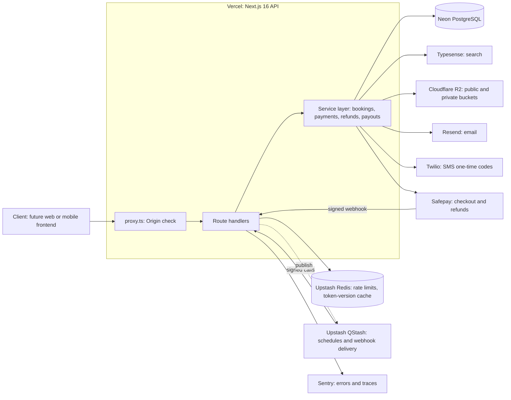
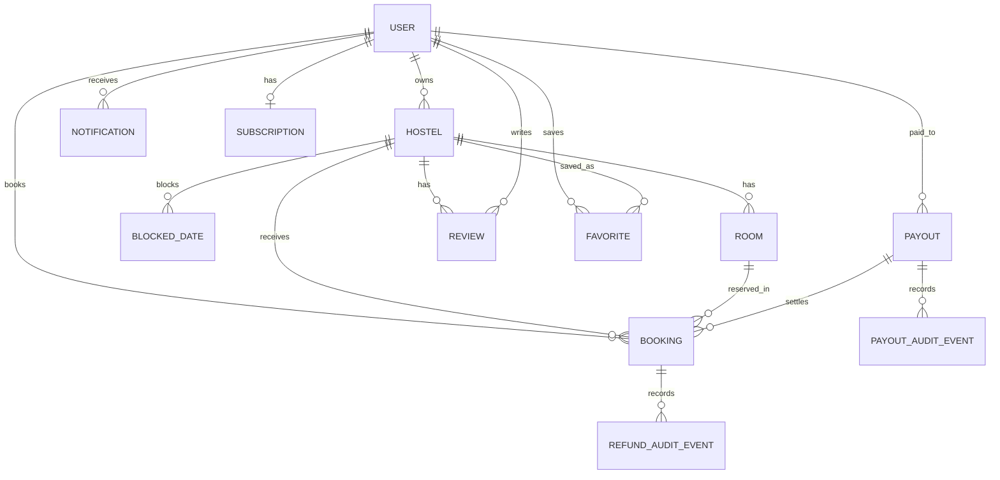
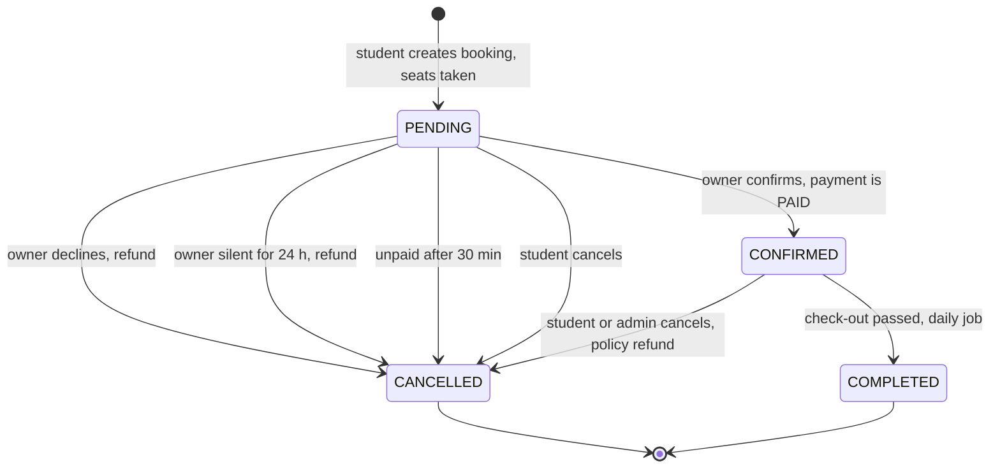
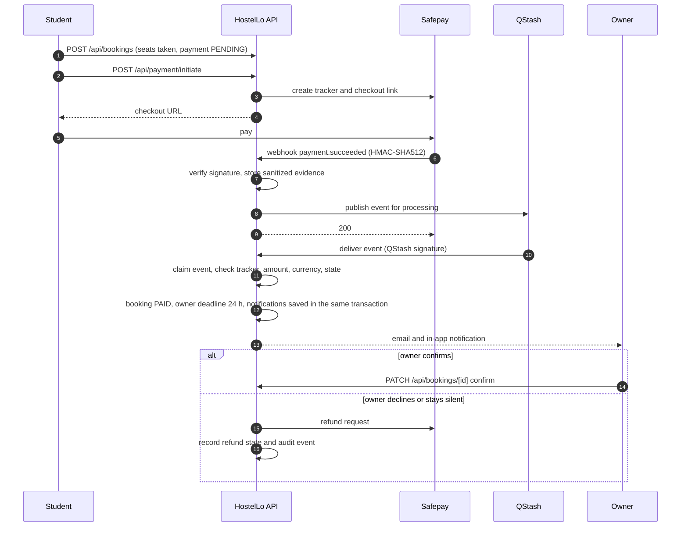
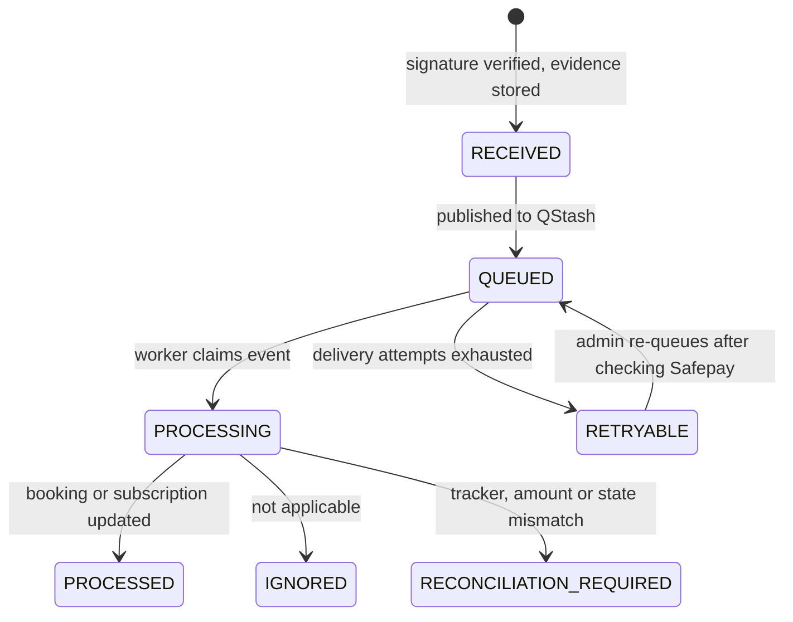
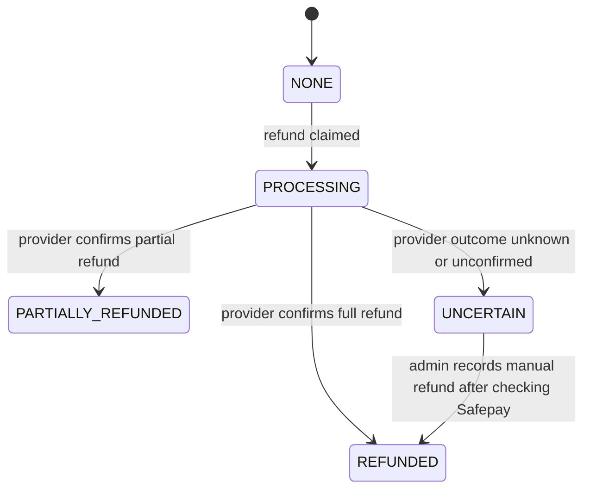
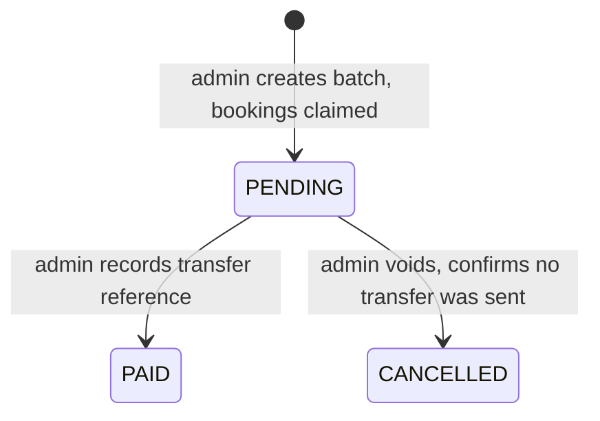
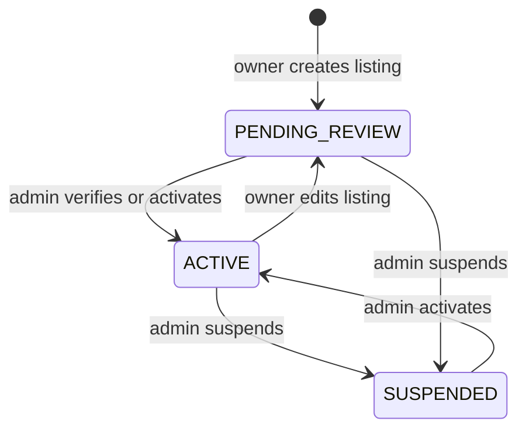

# HostelLo System Design

| | |
|---|---|
| **Version** | 4.2 |
| **Verified against code** | October 24, 2026 (repository snapshot `HostelLo.zip` plus the Phase 0 and Phase 1 changes) |
| **Stage** | Pre-launch, backend only. Not cleared for real transaction volume; see the [risk register](#16-risk-register). |
| **Document owner** | _To be assigned_ |

## How to read this document

Statements fall into three kinds, and the document says which:

- **Verified:** checked against the code, with the file named where it helps.
- **Operational:** a property of Neon, Vercel, Upstash, Sentry or another provider console that cannot be verified from source. Marked _(operational)_.
- **Proposed / Decision:** not built yet. Marked **Proposed** or **Decision needed**.

| Document | Contents |
|---|---|
| `SYSTEM.md` (this file) | What the system is, why it is built this way, how its lifecycles work, what is known to be wrong |
| [`CHANGELOG.md`](CHANGELOG.md) | Revision history and archived verification notes |
| [`docs/SECURITY-CONTROLS.md`](docs/SECURITY-CONTROLS.md) | Inventory of implemented security controls, rate limits and open verification items |
| [`docs/ENGINEERING-PRINCIPLES.md`](docs/ENGINEERING-PRINCIPLES.md) | Design guardrails the team follows |
| [`prisma/MIGRATIONS.md`](prisma/MIGRATIONS.md) | Migration ledger |
| `scripts/check-docs.mjs` | Fails CI when the facts below or the environment-variable list drift from the code |

The earlier design document pointed to runbooks under `docs/` (`OPERATIONS-RUNBOOK.md`, `LAUNCH-OPERATIONS-RUNBOOK.md`, `PRIVATE-STUDENT-VERIFICATION.md`, `CI-CD-GUIDE.md`) and to `DESIGN.md`. They were not in the archive this version was verified against. Confirm they exist and link them here once they do (R-20).

### Repository facts (generated)

Do not edit by hand. Run `node scripts/check-docs.mjs --write` after changing routes, models, migrations, tests or cron jobs.

<!-- docs-check:begin -->
| Fact | Value |
|---|---:|
| Page files (`src/app/**/page.tsx`) | 8 |
| API route handler files | 73 |
| Prisma models | 29 |
| Prisma migrations | 31 |
| Vitest test files | 128 |
| Cron jobs in the schedule registry | 7 |
| Cron route handlers | 7 |
<!-- docs-check:end -->

---

## 1. Purpose and scope

HostelLo is a Pakistan-focused student hostel marketplace. Students search for hostels, book a room and pay online. Owners list hostels and respond to booking requests. Admins moderate listings, verify students, and handle refunds and payouts.

| Actor | What they do |
|---|---|
| Student | Search and compare hostels, check availability, book and pay, cancel, review completed stays, message owners, save favorites, set price alerts, post to the roommate finder |
| Owner | Create and edit listings and rooms, block dates, accept or decline paid booking requests, reply to reviews, message students, view analytics and earnings, buy the Pro plan |
| Admin | Approve or suspend listings, verify student identities, moderate reviews and roommate posts, issue refunds, create payout batches, reconcile payment events, sync the search index |
| System | QStash-triggered cron jobs, Safepay webhooks |

**Current state.** The repository is an API-only Next.js 16 application: route handlers under `src/app/api` and the root layout the framework requires, with no pages or UI components. The web UI was removed on October 19, 2026 for a redesign, and native mobile support (bearer-token bridge, push notifications, mobile checkout redirects) was retired on October 16, 2026. The backend still emits some links and redirects to pages that no longer exist (R-09).

**Out of scope for the MVP:** separate backend services, international expansion and multi-currency, native mobile apps, offline search, video reviews, Apple Pay and Google Pay until Safepay support is confirmed.

---

## 2. Requirements

### 2.1 Business rules (as implemented)

| Rule | Behavior | Source |
|---|---|---|
| Booking price | `pricePerMonth × months × guests`, whole PKR, computed on the server from the room price. 1 to 4 guests per booking | `booking-service.ts`, shared validations |
| Billable months | Calendar-month difference between check-in and check-out, minimum 1. Day of month is ignored (R-02) | `packages/shared/src/utils/dates.ts` |
| Payment hold | A booking with unpaid payment is cancelled and its seats released after 30 minutes; the job runs every 5 minutes | `cron/cancel-abandoned-payments` |
| Owner response window | 24 hours from payment confirmation. If the owner has not confirmed or declined, a job running every 15 minutes cancels the booking and refunds it in full | `cron/expire-unanswered-bookings` |
| Who sees a request | Owner booking lists show paid bookings only; confirm and decline require `PAID` | `bookings` routes |
| Student cancellation | Allowed while `PENDING` or `CONFIRMED` and before check-out. Paid `PENDING` bookings are refunded in full. Paid `CONFIRMED` bookings are refunded under the cancellation policy snapshot. Not allowed once a payout batch has claimed the booking | `bookings/[id]/route.ts` |
| Owner decline, admin cancel | Paid bookings are refunded in full | `bookings/[id]/route.ts` |
| Cancellation policies | See the table below | `cancellation-policy.ts` |
| Listing quota | Free plan: 1 listing. Pro plan: unlimited, PKR 3,000. Enforced in a serializable transaction | `config/plans.ts`, `hostels/route.ts` |
| Listing review | New listings and every owner edit return to `PENDING_REVIEW`; pending listings are removed from the search index | `hostel-service.ts` |
| Listing images | At most 15 per hostel, 4 MB each, JPEG, PNG or WebP, signature-checked | shared config, `upload/route.ts` |
| Reviews | Students only, only for a hostel where they have a `COMPLETED` booking, one per student per hostel, length-limited comment | `reviews/route.ts`, schema |
| Roommate posts | Hidden once three different students report them | roommate routes |
| Pagination | Default page size 12, maximum 50, maximum page 10,000 | shared config |
| Payout eligibility | Owner's booking is `CONFIRMED` or `COMPLETED`, `PAID`, check-out has passed, and it is in no payout batch | `payouts.ts` |

Cancellation policies (refund share of the amount paid, by time before check-in):

| Policy | 100% | 50% | 0% |
|---|---|---|---|
| Flexible | 48 hours or more | 24 to 48 hours | under 24 hours, or after check-in |
| Standard | 7 days or more | 72 hours to 7 days | under 72 hours, or after check-in |
| Strict | never | 14 days or more | under 14 days, or after check-in |

Rules stored but **not** enforced: owner-defined `minStay` and `maxStay` on a hostel; the shared `MIN_BOOKING_MONTHS` and `MAX_BOOKING_MONTHS` (1 and 24); owner-blocked dates at booking time. See R-01 and R-02.

### 2.2 Non-functional requirements

No availability, latency, throughput or recovery targets were defined in the previous document. The values below are **Proposed** starting points for the launch scale. Confirm or replace them, then track them in alerts.

| Area | Proposed target | Why |
|---|---|---|
| API availability | 99.5% monthly for booking, payment and webhook endpoints | Money paths matter more than browse paths |
| Latency (p95, server side) | Search under 500 ms; booking create under 1 s; availability under 300 ms | Mobile networks in Pakistan add 200 to 300 ms of round-trip before the server answers |
| Webhook handling | Acknowledge a Safepay event within 5 s; business changes applied within 60 s of acknowledgement | Matches the store-then-process design in §5.2 |
| Data recovery | RPO 15 minutes or better (Neon point-in-time recovery), RTO 4 hours, restore rehearsed quarterly | Currently only a to-do (R-16) |
| Money integrity | Zero unreconciled payments or refunds older than 24 hours | Gives the reconciliation job a testable goal |
| Delivery of owner notifications | Email within 5 minutes of a paid request | The 24-hour response window runs against the owner |

**Capacity assumptions: needs your input.** Sizing has never been written down. Please fill these in; they decide the database tier, the connection budget and whether caching is needed:

| Question | Launch | 12 months |
|---|---|---|
| Active listings | _ | _ |
| Monthly active students | _ | _ |
| Bookings per day (average, peak week) | _ | _ |
| Peak API requests per second | _ | _ |
| Cities covered | _ | _ |

---
## 3. Architecture

### 3.1 System context



The application is intentionally one deployable unit: route handlers, business logic and schema ship together. There are no separate services.

### 3.2 Technology

| Layer | Implementation |
|---|---|
| Runtime | Next.js 16 App Router on Vercel; the root layout is kept only because the framework requires it |
| Database | Neon PostgreSQL through Prisma 7 with `@prisma/adapter-pg` (node-postgres) |
| Authentication | Auth.js (NextAuth v5 beta), JWT sessions in HTTP-only cookies; Credentials provider plus optional Google OAuth |
| Search | Typesense, with a Prisma (`ILIKE`) fallback |
| Cache and rate limits | Upstash Redis |
| Scheduling and webhook delivery | Upstash QStash calling signed route handlers |
| Object storage | Cloudflare R2: a public bucket for listing images and a private bucket for student verification documents |
| Email, SMS | Resend, Twilio |
| Payments | Safepay (enabled). JazzCash and EasyPaisa code is present but disabled |
| Observability | Sentry (data minimized) and structured JSON events from `src/lib/operational-logger.ts` with request correlation and HMAC pseudonyms |
| Tests | Vitest |

### 3.3 Request lifecycle

1. **Origin check** (`src/proxy.ts`). In production, a state-changing `/api` request must carry an `Origin` header equal to the configured app URL. Auth.js sign-in, callback and sign-out, cron, and payment webhook/callback routes are exempt. This is not the authorization boundary.
2. **Rate limit.** Upstash sliding window keyed by the Vercel-trusted client IP or by user. If Redis fails in production, a per-instance in-memory limiter takes over. It does not coordinate across instances.
3. **Authentication.** `auth()` verifies the JWT and checks `tokenVersion` against a Redis cache (5-minute TTL, database fallback). A stale or malformed token returns no session.
4. **Validation.** The body is streamed through a byte cap, then parsed with Zod. Query strings and path identifiers have length caps.
5. **Service function.** Role and ownership are enforced again in the write predicate. State changes use conditional updates so concurrent requests cannot both win.
6. **Response.** Typed domain errors map to 4xx (stale-state conflicts to 409). Unexpected failures return a generic 500 and log a safe error summary.
7. **Side effects.** In-app notifications are database writes: they are awaited, and for payment events they are written in the same transaction as the state change. Emails and search-index updates run after the response through `runAfterResponse` (`src/lib/background.ts`, built on Next's `after()`), so the platform keeps the invocation alive until they finish. A failure is logged as `<event>.failed` and never reaches the caller. Outside a request scope (scripts, tests) the same helper runs the task immediately.

### 3.4 Deployment and environments

- **Toolchain:** Node 24 (`.nvmrc`, and `engines.node` in `package.json`, which Vercel also reads) and npm 10.9 or newer. CI and Vercel therefore run the same Node major. The committed lockfile must pass `npm ci`.
- **Pull requests:** CI installs with `npm ci`, then runs the documentation drift check, script tests, type check, Vitest suite and lint, and type-checks the shared package on its own. A Preview is deployed only after those pass.
- **Production:** a push to `main` runs its own gate (the same checks), then the `deploy` job. The job runs in the GitHub Environment `production`, which is where required reviewers are configured, so a deploy can wait for approval. It then creates a Neon branch of the production database (a snapshot, expiring after 14 days by default), applies migrations with `prisma migrate deploy` against Vercel's Production environment, builds, and deploys. The Vercel build never applies migrations.
- **Preview schema changes:** a manually dispatched workflow checks the Preview database host and name against GitHub Environment variables before migrating.
- **Weekly dependency audit:** `audit.yml` blocks on production dependencies and reports development-only findings without failing.
- **Pinned tooling and permissions:** the Vercel CLI is pinned to a release older than two weeks, and every workflow runs with read-only repository permissions unless a job declares more.

GitHub configuration the pipeline reads (set in the `production` environment):

| Name | Kind | Purpose |
|---|---|---|
| `VERCEL_TOKEN`, `VERCEL_ORG_ID`, `VERCEL_PROJECT_ID` | Secrets | Vercel CLI |
| `NEON_API_KEY` | Secret | Creates the pre-migration snapshot branch |
| `NEON_PROJECT_ID`, `NEON_PRODUCTION_BRANCH_ID` | Variables | Which project and branch to snapshot |
| `NEON_SNAPSHOT_REQUIRED` | Variable | Set to `true` to fail the deploy when the snapshot cannot be taken. While unset, the step only warns |
| `NEON_SNAPSHOT_TTL_DAYS` | Variable, optional | Snapshot lifetime in days (default 14) |

Open console steps for this pipeline are listed under R-06.

### 3.5 Configuration

The canonical list is `.env.example` (and `.env.sentry.example`). `scripts/check-docs.mjs` fails when a variable the code reads is missing from those files, or when a variable in them is missing from this table.

| Group | Variables | Checked at startup in production |
|---|---|---|
| Core | `DATABASE_URL`, `AUTH_SECRET`, `AUTH_URL` | Required |
| Legacy alias | `NEXTAUTH_SECRET` | No. Fallback for `AUTH_SECRET` when signing unsubscribe tokens and pseudonymizing log identifiers; remove once `AUTH_SECRET` is confirmed everywhere |
| Preview migrations | `HOSTELLO_MIGRATION_TARGET` | No. Set to `preview` only by the preview-migration workflow; `scripts/migrate-preview.mjs` refuses to run otherwise |
| Public URLs | `NEXT_PUBLIC_APP_URL`, `APP_URL` | No. `AUTH_URL` is the canonical origin (see D-1) |
| Payout encryption | `PAYOUT_DESTINATION_ENCRYPTION_KEY` | Warns in production when missing; payout creation fails with 503 without it |
| Google sign-in (optional) | `AUTH_GOOGLE_ID`, `AUTH_GOOGLE_SECRET` | Optional |
| Storage | `R2_ACCOUNT_ID`, `R2_ACCESS_KEY_ID`, `R2_SECRET_ACCESS_KEY`, `R2_BUCKET_NAME`, `R2_PUBLIC_URL`, `R2_VERIFICATION_BUCKET_NAME`, `R2_VERIFICATION_ACCESS_KEY_ID`, `R2_VERIFICATION_SECRET_ACCESS_KEY` | Required |
| Redis | `UPSTASH_REDIS_REST_URL`, `UPSTASH_REDIS_REST_TOKEN` | Required |
| Safepay | `SAFEPAY_SECRET`, `SAFEPAY_API_KEY`, `SAFEPAY_WEBHOOK_SECRET` | Required |
| Safepay environment | `NEXT_PUBLIC_SAFEPAY_ENV` | Required in production, and must be `production` or `sandbox`. `sandbox` is allowed but logged as a warning |
| Safepay (rotation) | `SAFEPAY_WEBHOOK_SECRET_PREVIOUS`, `SAFEPAY_WEBHOOK_SECRET_PREVIOUS_UNTIL` (overlap of at most 72 hours) | Optional |
| JazzCash, EasyPaisa (disabled) | `JAZZCASH_MERCHANT_ID`, `JAZZCASH_PASSWORD`, `JAZZCASH_INTEGRITY_SALT`, `JAZZCASH_ENV`, `EASYPAISA_STORE_ID`, `EASYPAISA_HASH_KEY`, `EASYPAISA_ENV`, `GATEWAY_IPS` | Optional |
| Email | `RESEND_API_KEY`, `EMAIL_FROM` | Required. `RESEND_API_KEY` must start with `re_` and must not be the placeholder |
| Email (support address) | `SUPPORT_EMAIL` | No |
| SMS | `TWILIO_ACCOUNT_SID`, `TWILIO_AUTH_TOKEN`, `TWILIO_PHONE_NUMBER` | Warns in production when missing; phone verification fails closed without them |
| Search | `TYPESENSE_HOST`, `TYPESENSE_PORT`, `TYPESENSE_PROTOCOL`, `TYPESENSE_API_KEY` | Optional; without them search uses the database |
| Jobs | `CRON_SECRET`, `QSTASH_TOKEN`, `QSTASH_CURRENT_SIGNING_KEY`, `QSTASH_NEXT_SIGNING_KEY` | Required |
| Jobs (optional) | `QSTASH_URL` | Optional regional endpoint |
| Observability | `SENTRY_DSN`, `NEXT_PUBLIC_SENTRY_DSN`, `SENTRY_ORG`, `SENTRY_PROJECT`, `SENTRY_AUTH_TOKEN` | Optional |
| Seeding (local only, never production) | `SEED_ADMIN_EMAIL`, `SEED_ADMIN_PASSWORD`, `SEED_OWNER_PASSWORD`, `SEED_STUDENT_PASSWORD`, `SEED_OWNER_1_EMAIL`, `SEED_OWNER_2_EMAIL`, `SEED_OWNER_3_EMAIL`, `SEED_OWNER_4_EMAIL`, `SEED_STUDENT_EMAIL` | n/a |

### 3.6 Client topology

**Decision needed (D-1).** The backend assumes a first-party, same-origin browser client: cookie sessions, and an `Origin` check that must equal the API's own configured URL. There is no CORS handling, so a separately hosted web app, a mobile app or a plain API client is rejected in production. One variable (`AUTH_URL`) also serves as email-link base, payment-redirect base, Auth.js base and QStash callback target. See D-1 in §15 for options.

---

## 4. Domain model

The schema is `prisma/schema.prisma`.

### 4.1 Entity relationships



### 4.2 Models (28)

| Area | Models |
|---|---|
| Identity and auth | `User`, `Account`, `Session`, `VerificationToken`, `PasswordResetToken`, `PhoneVerificationToken`, `AccountDeletionJob` |
| Listings and community | `Hostel`, `Room`, `BlockedDate`, `HostelVerificationReview`, `Review`, `Favorite`, `PriceAlert`, `RoommatePost`, `RoommateReport` |
| Bookings and money | `Booking`, `RefundAuditEvent`, `SafepayWebhookEvent`, `SafepayWebhookReplayEvent`, `Payout`, `PayoutAuditEvent`, `Subscription` |
| Messaging and notifications | `Conversation`, `ConversationParticipant`, `Message`, `Notification` |
| Operations | `CronLog` |

Money is stored as integer PKR and converted to paisas only at the Safepay boundary. Review counts and ratings are denormalized on `Hostel` and maintained transactionally, with repair scripts available. `Account`, `Session` and `VerificationToken` are Auth.js adapter tables; sessions use JWTs, so `Session` rows are not the source of truth.

`Room.available` is a seat counter with an optimistic-lock `version`. It is the center of R-01.

### 4.3 Invariants and where they are enforced

| Invariant | Enforced by | Gap |
|---|---|---|
| One Safepay tracker maps to one booking | Database unique constraint on `Booking.transactionId` | |
| Webhook delivery is idempotent | Unique body hash on `SafepayWebhookEvent` | |
| One review per student per hostel | Database unique constraint | |
| Payout audit events cannot change | Database triggers reject update, delete and truncate; CHECK constraints on the table | |
| A booking joins at most one payout and cannot be cancelled after a batch claims it | Conditional updates with `payoutId: null` in the write predicate | Application only |
| Owner plan quota | Serializable transaction with bounded retry | Application only |
| Seats never negative or above capacity | Optimistic lock and a post-update check | **No CHECK constraint**; counter is also never restored on stay completion (R-01) |
| Check-out after check-in, amounts non-negative, refunded amount at most total | Zod validation | **No CHECK constraints** (R-12) |
| Status-like values | Prisma enums for booking, payment, refund, payout, listing and webhook-event status | `paymentMethod`, `AccountDeletionJob.status` and `phase`, `CronLog.status` are free strings (R-12) |
| `Hostel.rooms` and `capacity` match its `Room` rows | Application | Denormalized; can drift (R-12) |

### 4.4 Data classification and retention

| Class | Examples | Where it lives | Protection | Retention |
|---|---|---|---|---|
| Public listing data | Hostel name, location, prices, amenities, ratings, images | Postgres, Typesense, R2 public bucket | Active listings only are returned publicly; image URLs allow-listed | While listed |
| Account identity | Name, email, phone, role | Postgres `User` | Auth required; never in logs (pseudonymized) | Until account deletion |
| Credentials | Password hash (bcrypt, cost 12, 72-byte cap), reset and verification tokens (SHA-256 digests), phone one-time codes (stored in plaintext, 10-minute expiry, 5 attempts) | Postgres | Short-lived, single-use; expired tokens removed daily | Short |
| Financial | Booking amounts, Safepay tracker IDs, refund and payout records | Postgres | Append-only audit tables; payout destination snapshots encrypted with AES-256-GCM | Kept after account deletion with the account anonymized |
| Owner bank details | Account title, number, bank name | Postgres `User` (plaintext) and `Payout` (encrypted snapshot) | Admin-only reads; snapshot encrypted, the source columns are not (R-12) | Until the owner edits or deletes them |
| Student identity documents | ID image for student verification | Private R2 bucket | Separate bucket and token; copy-on-submit to immutable keys; admins stream through an authenticated no-store route | Abandoned uploads removed hourly; **retention after review is undefined** |
| Messages and reviews | Conversation text, review text | Postgres | Participant-only reads | Deleted with the account |
| Operational logs | Structured events, Sentry events | Vercel and Sentry _(operational)_ | Allow-listed fields, HMAC pseudonyms, SDK payload collection disabled | Provider defaults; **set explicitly** |

**Decision needed (D-6):** retention periods for student documents, rejected verification records, messages, and logs; and whether owner bank details should be encrypted at rest on `User`.

---
## 5. Lifecycles and state machines

### 5.1 Booking



Every transition is a conditional update that names the state it expects, so two concurrent actions cannot both succeed. Notifications and emails follow the transition.

| Transition | Seats returned to `Room.available`? |
|---|---|
| Owner declines | Yes |
| Owner silent for 24 hours (cron) | Yes |
| Unpaid after 30 minutes (cron) | Yes |
| Student or admin cancels | Only if check-in is still in the future |
| Stay completes (cron) | **No** (R-01) |

### 5.2 Payment and webhook

Payment status is `PENDING`, `PAID`, `FAILED`, `PARTIALLY_REFUNDED` or `REFUNDED`. A failed payment can be retried; a retry creates a new Safepay tracker. A successful payment after the booking was already cancelled leaves it `CANCELLED` and `PAID` for manual refund review.



The webhook endpoint serves two callers on one URL. Safepay's request is verified by HMAC and stored (ingress). QStash's request carries an Upstash signature and applies the business change (worker).

Webhook event states:



A claim that has been `PROCESSING` for more than five minutes is treated as stale and can be reclaimed. `RECONCILIATION_REQUIRED` events are never replayed automatically; an admin resolves them in Safepay. Re-queues are recorded in `SafepayWebhookReplayEvent`.

### 5.3 Refund



Automatic refunds start from owner decline, owner timeout and student cancellation of a paid booking. An admin can also trigger a refund for a cancelled, paid booking through `PATCH /api/admin/bookings/[id]/refund`. A full refund counts as confirmed only when Safepay returns the tracker state `TRACKER_REFUNDED`. Each attempt, provider outcome and manual confirmation is an append-only `RefundAuditEvent`. No scheduled job retries a booking that is `CANCELLED` and `PAID` with refund state `NONE` after a crash between commit and refund (R-04).

### 5.4 Payout



Batch creation claims eligible bookings with a conditional update, computes the amount with a database aggregate, and stores an AES-256-GCM encrypted snapshot of the owner's bank destination. The transfer itself happens outside the product. `PayoutAuditEvent` records creation, payment and void in an append-only table.

### 5.5 Listing



`DRAFT` exists in the enum but no API path creates it. Verifying a listing (the verified badge) requires the admin to confirm location, listing details and photos. Suspended listings cannot be edited by the owner and are hidden from public reads, alerts and favorites. Only `ACTIVE` listings appear in search; the database re-checks status when hydrating Typesense hits.

### 5.6 Student verification

`NONE` to `PENDING` when a student submits a document, then `APPROVED` or `REJECTED` by an admin. Only applications still `PENDING` can be decided; a stale decision returns a conflict.

### 5.7 Account deletion

A deletion request creates an `AccountDeletionJob`. A worker running every minute advances it through resumable, keyset-batched phases: notifications, messages, participants, favorites, price alerts, roommate reports and posts, reviews, reset and phone tokens, sessions, linked accounts, bookings, hostels, the private verification document, then anonymization of bookings and payouts, and finalization. Completed financial history is kept with the account anonymized. Deletion is blocked while stays, refunds, payouts or plan payments need attention.

---

## 6. API surface

All endpoints live under `/api`. Responses generally use `{ "data": {}, "message": "...", "error": "..." }`, but list endpoints add their own pagination fields and errors often carry only `error`; there is no error-code catalogue and no OpenAPI document (R-09).

**Access levels:** _Public_ (rate limited), _Signed in_ (any role), _Student_, _Owner_, _Admin_, _Participant_ (party to the conversation), _HMAC_ (provider signature), _QStash_ (Upstash signature, or `CRON_SECRET` bearer).

| Area | Endpoints | Access |
|---|---|---|
| Sign-up and sign-in | `/api/auth/signup`, `/api/auth/[...nextauth]` (Auth.js: credentials, Google, session, sign-out), `/api/auth/email-otp` (request a sign-in code), `/api/auth/email-otp/verify` (verify the code) | Public |
| Email verification and password reset | `/api/auth/verify-email` (GET renders a confirmation form, POST consumes the token), `/api/auth/forgot-password`, `/api/auth/reset-password` | Public |
| | `/api/auth/resend-verification` | Signed in |
| Phone verification | `/api/auth/phone/request-otp`, `/api/auth/phone/verify-otp` | Signed in |
| Account | `/api/auth/delete-account` (not for admins), `/api/profile`, `/api/profile/change-password` | Signed in |
| Student verification | `/api/user/verify-student`, `/api/user/verify-student/upload` | Student |
| Hostels | `/api/hostels` (GET search is public; POST creates a listing as Owner), `/api/hostels/mine` | Public / Owner |
| | `/api/hostels/[param]` (GET returns owner contact details, Admin; PATCH edits the listing, Owner) | Admin / Owner |
| | `/api/hostels/[param]/availability`, `/api/hostels/[param]/view` (view counter) | Public |
| | `/api/hostels/[param]/favorite`, `/api/hostels/[param]/roommates` | Student |
| | `/api/favorites` | Signed in |
| Roommates | `/api/roommates/[id]` (author deletes own post), `/api/roommates/[id]/report` (Student) | Signed in / Student |
| Bookings | `/api/bookings`, `/api/bookings/[id]` (student, owner or admin, each scoped to their own records) | Signed in |
| Payments | `/api/payment/initiate` (the booking's student) | Signed in |
| | `/api/payment/webhook` (Safepay ingress and QStash worker), `/api/payment/webhook/failure` (QStash failure callback) | HMAC / QStash |
| | `/api/payment/callback` (gateway return; JazzCash and EasyPaisa disabled) | Gateway |
| Reviews | `/api/reviews` (GET public per hostel, or all for admins; POST Student), `/api/reviews/mine` | Mixed / Owner |
| | `/api/reviews/[id]` (delete, Admin), `/api/reviews/[id]/reply` (Owner or Admin) | Admin / Owner |
| Messaging | `/api/conversations` (start with an active hostel, Student), `/api/conversations/[id]` | Participant |
| Notifications | `/api/notifications`, `/api/notifications/[id]` | Signed in |
| Price alerts and email preferences | `/api/price-alerts`, `/api/price-alerts/[id]` (Signed in); `/api/alerts/unsubscribe`, `/api/email/unsubscribe` (signed token) | Signed in / Public |
| Owner tools | `/api/owner/analytics`, `/api/owner/earnings` (earnings and bank details), `/api/owner/hostels/[id]/blocked-dates`, `/api/owner/subscription` | Owner |
| Admin: listings and search | `/api/admin/listings`, `/api/admin/listings/stats`, `/api/admin/hostels` (verify, activate, suspend), `/api/admin/search/sync` | Admin |
| Admin: people and community | `/api/admin/verifications`, `/api/admin/verifications/analytics`, `/api/admin/verifications/[userId]/document`, `/api/admin/roommate-reports`, `/api/admin/roommate-reports/[postId]` | Admin |
| Admin: money | `/api/admin/bookings/[id]/refund`, `/api/admin/payouts`, `/api/admin/payouts/[id]`, `/api/admin/payment-events`, `/api/admin/payment-events/[id]/retry` | Admin |
| Uploads | `/api/upload` (listing images; Owner or Admin when `hostelId` is given, otherwise any signed-in user, R-11) | Signed in |
| Support | `/api/contact`, `/api/report` | Signed in |
| Health | `/api/health/crons`, `/api/health/payments` | Admin |
| Jobs | `/api/cron/cancel-abandoned-payments`, `/api/cron/check-price-alerts`, `/api/cron/cleanup-tokens`, `/api/cron/cleanup-verification-uploads`, `/api/cron/expire-unanswered-bookings`, `/api/cron/mark-completed-stays`, `/api/cron/process-account-deletions` | QStash |

---

## 7. Authentication and authorization

**Sign-in.** Email and password through the Auth.js Credentials provider, plus optional Google OAuth (Prisma adapter; creates a student account with a verified email). Passwords use bcrypt cost 12 and are limited to 72 UTF-8 bytes so bcrypt never silently truncates them.

**Sessions.** JWT in an HTTP-only cookie. The JWT callback checks `tokenVersion` on every session read, against a Redis cache with a 5-minute TTL and a database fallback. A stale or malformed token yields no session. Password change and reset increment `tokenVersion`; any role change must do the same and invalidate the cache entry. No explicit session lifetime is configured, so the Auth.js default (30 days) applies.

**Sign-in throttling.** Two independent buckets: 10 attempts per 15 minutes per trusted client IP, and 5 per 15 minutes per account (keyed by HMAC of the email). Both count every attempt, before the password is checked (R-10).

**Verification.**

- Email: a hashed single-use token. The link's GET only renders a confirmation form; a same-origin POST consumes it, so mail scanners cannot.
- Phone: six-digit code, 10-minute expiry, five attempts, consumed atomically with the change it authorizes.
- Email, phone and student verification are recorded on the user but **no endpoint requires them** (D-5).

**Roles and ownership.**

| Role | Scope |
|---|---|
| Student | Own bookings, reviews, favorites, alerts, messages, profile; roommate posts and reports; student verification |
| Owner | Own hostels and their bookings, messages, reviews, blocked dates, earnings and bank details, subscription |
| Admin | Listing moderation, student verification, review and roommate moderation, refunds, payout batches, payment-event reconciliation, search sync |

Authorization happens at the data boundary, not in the proxy. Handlers check the role, then put the user's ID or the owner relation into the database write predicate, and answer 404 for both absent and foreign records. A stale owner edit therefore cannot undo an admin suspension.

**Origin check.** See §3.3 and D-1.

**Gaps.** There is no admin API to list, suspend or change the role of a user, no multi-factor authentication for admins, and no second approver for refunds and payouts (R-10).

---

## 8. Money movement

### 8.1 Safepay checkout and settlement

- `POST /api/payment/initiate` creates a Safepay v3 tracker and a hosted checkout link. The tracker is stored in `Booking.transactionId`; a retry while the payment is pending reuses it. Amounts are whole PKR in the database and paisas at the Safepay boundary.
- The webhook is the source of truth. It accepts `payment.succeeded` and `payment.failed`, verifies HMAC-SHA512 over the raw body and the merchant key, and during key rotation accepts a configured previous secret until an expiry of at most 72 hours.
- Ingress stores sanitized evidence (the merchant key is redacted; a body hash makes redelivery idempotent) and publishes to QStash. The worker checks order, tracker, provider, terminal state (`TRACKER_ENDED` for success), currency and exact amount, then applies a conditional booking transition.
- Conditional updates bind provider and tracker, so duplicates cannot settle twice and a delayed success cannot revive a cancelled booking.
- **Expect late payments.** With a 30-minute hold, a student who pays after the cancellation job ran produces a `CANCELLED` and `PAID` booking that needs manual refund review. A bank or 3-D Secure delay makes this common, not rare.
- Checkout requests to Safepay time out after 10 seconds and refund requests after 15. A timeout surfaces as a failed payment setup, and the student can retry.

### 8.2 Refunds

See §5.3. Operators verify provider state before recording a manual refund. Sandbox validation of the refund call is still open (R-04).

### 8.3 Payouts

Admins create a manual batch per owner from eligible bookings (§2.1). One shared predicate defines eligibility for the owner's pending balance, the admin queue and the transactional claim. Batch creation re-checks the OWNER role and requires a complete bank destination. Marking a batch paid requires a transfer reference, which is operator evidence, not provider settlement. Voiding needs a reason and explicit confirmation that no transfer was sent.

**Decision needed (D-3): payout timing and custody.** Students pay `price × months × guests` at booking, and eligibility requires `checkOut` to have passed. An owner with a six-month tenant is therefore paid when the stay ends, and HostelLo holds the money in between.

### 8.4 Owner subscription

Pro costs PKR 3,000 through a Safepay checkout. The webhook sets `plan = PRO` and a one-month `endDate`. **Nothing ever reverts the plan or marks the subscription expired**, and the endpoint refuses a second purchase with "Already on Pro plan" (R-19). The earlier document described this as one month of access; the code grants it permanently.

### 8.5 What is not modeled

No double-entry ledger, no fee or commission accounting (payout equals the gross booking total, and Safepay's processing fee is not recorded), no payout reversal, and no reconciliation of Safepay settlements against HostelLo's records. Revenue today is the Pro subscription only. These need an approved accounting model before real volume (R-05).

### 8.6 JazzCash and EasyPaisa

Both are disabled. The callback route still ships: JazzCash callbacks fail closed without an integrity salt, compare the HMAC in constant time and optionally enforce a gateway IP allow-list; EasyPaisa redirects are unsigned and cannot settle a booking. Before enabling either, bind the provider reference to the selected booking to prevent cross-booking replay, or delete the code (R-18).

---
## 9. Background jobs

Seven jobs run on QStash schedules. The schedule, endpoint and health-freshness threshold are defined once in `src/lib/cron-schedules.ts`, which both the registration script (`npm run schedule-cron`) and the health endpoint read.

| Job | Schedule (UTC) | What it does | Alert if older than |
|---|---|---|---|
| `cancel-abandoned-payments` | every 5 minutes | Cancels bookings whose payment has been pending more than 30 minutes and returns their seats | 10 minutes |
| `expire-unanswered-bookings` | every 15 minutes | Reminds owners before the deadline; cancels and refunds paid bookings the owner has not answered within 24 hours | 30 minutes |
| `check-price-alerts` | every 6 hours | Emails users when an active hostel's price drops to their target | 8 hours |
| `cleanup-tokens` | daily at 01:00 | Deletes expired password-reset, verification and phone tokens | 26 hours |
| `cleanup-verification-uploads` | hourly | Deletes abandoned temporary uploads from the private verification bucket | 2 hours |
| `mark-completed-stays` | daily at 00:00 | Moves `CONFIRMED` and `PAID` bookings past check-out to `COMPLETED`; completion notifications are written in the same transaction | 26 hours |
| `process-account-deletions` | every minute | Advances resumable account-deletion jobs (§5.7) | 3 minutes |

**Security.** `verifyUpstashRequest` validates the QStash JWT (signature, endpoint URL, body hash) with the official receiver, using the current and next signing keys so keys can rotate. A `CRON_SECRET` bearer token is also accepted for manual runs and legacy schedulers.

**Semantics.** Jobs process batches of 100 and use conditional updates, so a repeated run is safe. Each run writes a `CronLog` row before responding, and `GET /api/health/crons` reports freshness against the thresholds above. There is no durable general-purpose queue or outbox. In the price-alert job a crash between the email provider accepting a message and the database recording it can send a duplicate (R-07).

Helper scripts: `scripts/schedule-cron-jobs.ts`, `scripts/check-price-alerts.ts`, `scripts/setup-typesense.ts`, `scripts/verify-typesense-fallback.ts`.

---

## 10. Notifications and messaging

| Channel | Provider | Used for |
|---|---|---|
| In-app | `Notification` table, read through `/api/notifications` | Booking requested, confirmed, cancelled, completed, refunded; message received; review received; listing approved or rejected; student verification decided; price alert |
| Email | Resend | Verification and welcome, password reset, booking lifecycle, refunds, price alerts, admin moderation, support and report mail. Price-alert and global preferences can be changed through signed unsubscribe links |
| SMS | Twilio | Phone verification codes only. Without credentials the code is logged in development |

**Delivery guarantees.**

- **In-app notifications** are database rows. They are awaited, and for payment events (booking paid, Pro activated) they are written in the same transaction as the state change, so they exist if and only if the change was applied. If that transaction fails, the booking stays unpaid and QStash retries the event.
- **Emails** run after the response through `runAfterResponse`. This stops the platform from cutting them off, but they are still best effort: nothing retries a send that fails or an invocation that crashes. A durable outbox is the remaining step (R-07).
- The Safepay worker awaits its two emails before acknowledging; the completion job writes its notifications transactionally.
- In production, `sendEmail` returns a failure, and logs an error, when the Resend key is missing or a placeholder. Startup validation also rejects a malformed key (R-14).

**Messaging.** A student starts a conversation with an owner about an active hostel. Reads and writes are limited to participants (admins are not participants), paginated, and rate limited per user.

---

## 11. Search

`GET /api/hostels` searches Typesense when it is configured and healthy, and falls back to Prisma otherwise.

- **Filters:** text query, city, gender, price range, amenities, verified flag. **Sort:** newest, price ascending or descending, rating. Page size defaults to 12, maximum 50.
- **Index sync:** a listing is indexed when it becomes `ACTIVE`, re-indexed on change, and removed while it is pending review. Suspended listings are excluded by the database re-check below. `POST /api/admin/search/sync` runs a full reindex in 100-row keyset pages, limited to two per hour.
- **Safety net:** Typesense results are re-read from Postgres and kept only if the hostel is still `ACTIVE`, so a stale index cannot expose an unpublished listing.
- **Degraded mode:** the response says when the database fallback served it. An empty Typesense result also triggers the fallback so newly approved or seeded rows stay discoverable.

Known problems (R-13): `city` and amenity values are interpolated into Typesense `filter_by` without quoting or escaping; every zero-hit query runs `ILIKE` scans over five columns with no trigram index; and there is no university or distance search although hostels have coordinates and the shared package carries a university list. For a student marketplace, "near my campus" is the primary query, so treat this as a product gap and not only a technical one.

`GET /api/hostels/[param]/availability` returns a 12-month calendar. It is hostel-wide and date-based, computed from raw bookings and blocked dates on every request without caching, and disagrees with the room-level counter that gates booking (R-01).

---

## 12. Storage and uploads

| Bucket | Content | Rules |
|---|---|---|
| Public listing bucket | Hostel and room images | Up to 15 images per hostel, 4 MB each, JPEG, PNG or WebP, content signature checked. Submitted image URLs must match the configured public base URL. Objects are served with immutable long-lived cache headers |
| Private verification bucket | Student ID documents | Student-only upload through the app, 4 MiB cap, metadata and signature checks, copied on submit to immutable review keys. Admins read through an authenticated no-store route. Separate bucket-scoped token. Abandoned temporary uploads removed hourly |

Uploads pass through the API function and so share Vercel's 4.5 MB request-body limit. Images are stored as uploaded, with no resizing, thumbnails or EXIF stripping. See R-11 for upload scope and throttling, and the private-bucket setup note under open items in `docs/SECURITY-CONTROLS.md` (legacy student documents may still sit in the public bucket).

---

## 13. Security

Implemented controls are inventoried in [`docs/SECURITY-CONTROLS.md`](docs/SECURITY-CONTROLS.md). The principles behind them are in [`docs/ENGINEERING-PRINCIPLES.md`](docs/ENGINEERING-PRINCIPLES.md).

### 13.1 Threat model

| Threat | Existing controls | Gaps |
|---|---|---|
| **Account takeover** (credential stuffing, stolen token) | IP and account throttles, bcrypt, `tokenVersion` revocation, hashed single-use reset tokens | Lockout can be abused; email-existence leaks; no admin MFA (R-10) |
| **Forged or replayed payment event** | HMAC-SHA512 on the raw body, merchant key, exact tracker, amount and currency, body-hash dedupe, QStash-signed worker | Merchant and refund behavior unproven in sandbox (R-04) |
| **Overbooking** | Optimistic lock and post-update check on `Room.available` | Not date-aware, never restored on completion, no database constraint (R-01) |
| **Double or fraudulent refund** | Conditional claim, append-only audit events, `UNCERTAIN` state for unknown provider outcomes | Single admin can approve; stuck-refund sweeper missing (R-04, R-10) |
| **Payout fraud or error** | Encrypted destination snapshot, atomic claim, append-only audit with triggers | One admin creates and pays; no MFA; no settlement reconciliation (R-05, R-10) |
| **Exposure of PII, bank details, ID documents** | Private bucket, admin-only reads, pseudonymized logs, Sentry payload collection disabled | Plaintext bank details on `User`; retention undefined (R-12, D-6) |
| **Abuse and cost** (SMS pumping, upload abuse, search scans) | Per-IP and per-user limits, bounded bodies and pages, OTP caps | Limits may collide with carrier NAT; public-bucket uploads by any user; scan fallback (R-10, R-11, R-13) |
| **CSRF and session riding** | Auth.js cookie defaults and the Origin check | Breaks every non-same-origin client; see D-1 |
| **Supply chain** | Lockfile, weekly audit, production audit clean | Lockfile fails `npm ci`; about 30 unused dependencies; beta auth library (R-06, R-18) |
| **Admin or insider misuse** | Audit events for refunds, payouts and webhook retries | Booking and listing admin actions go only to stdout logs (R-10) |
| **Provider outage** (Redis, Typesense, QStash) | In-memory limiter, database search fallback, QStash retries | Unawaited side effects; no alerts (R-07, R-17) |

### 13.2 Principles

- Authorize at the data boundary; the proxy is not an authorization layer.
- Verify every provider callback before changing state, and treat uncertain outcomes as states to reconcile.
- Bound every request's work before doing it: body bytes, query length, page size, uploads.
- Log events, not payloads. Identifiers in audit events are keyed pseudonyms.

---

## 14. Reliability, operations and quality

### 14.1 Observability

- **Logs:** one JSON event per business event from `src/lib/operational-logger.ts`, with request and trace correlation and HMAC-pseudonymized identifiers. Raw emails and names are not logged.
- **Errors:** Sentry on client, server and edge, with request payloads, headers, cookies and query strings disabled and event data scrubbed. Tracing runs at a 100% sample rate; tune it once production volume is known _(operational)_.
- **Health:** `GET /api/health/crons` (job freshness) and `GET /api/health/payments` (returns 207 when webhook events are retryable or need reconciliation). Both require an admin session, so an external uptime monitor cannot poll them (R-17).
- **Alerts:** none configured for payment health, search degradation, notification delivery or cron failure (R-17).

### 14.2 Data and recovery

- The database is Neon PostgreSQL. Point-in-time recovery retention, RPO and RTO are unconfirmed, and no restore has been rehearsed (R-16).
- The node-postgres pool uses its default maximum per process. A serverless fleet multiplies that, and the runtime and migrations share one `DATABASE_URL` (R-12).
- **Migrations:** create with `npm run migrate:new`; apply in production with `npm run db:migrate:deploy`; the pre-commit hook blocks schema changes without a migration; the ledger is `prisma/MIGRATIONS.md`. Keep changes backward compatible across old and new app versions (expand, backfill, contract). Never edit SQL of a migration applied to a shared or production database; add a corrective one.

### 14.3 Release

Production deploys on every push to `main`, after an optional approval and a Neon snapshot (§3.4). Application rollback is a redeploy of an earlier Vercel build _(operational; confirm in the runbook)_; database changes are forward-only, which is why expand-and-contract matters. The runbooks that should describe rollback, restore, reconciliation and alert response are missing from the audited archive (R-20).

### 14.4 Testing and quality gates

Verified on October 24, 2026, on Node 22 and Node 24:

- 100 Vitest files with 686 tests, all passing, plus 6 `node:test` script tests (`npm run test:scripts`).
- `tsc --noEmit` passes. ESLint reports 0 errors and 1 warning.
- `npm audit --omit=dev` reported zero vulnerabilities on October 19; the full audit adds five high findings in a development-only dependency chain.

What the tests cover: handlers and validation, booking, search and review services, CSRF and rate limits, payments, notifications, profile and shared business logic.

What they do not cover: **none of the 100 files talks to a real database** (65 mock `@/lib/db`, and CI points `DATABASE_URL` at a placeholder), so concurrency claims such as "the conditional update wins the race" are asserted against mocks (R-15). Nothing exercises the Safepay sandbox. Browser E2E coverage was removed with the UI and is deferred until a frontend exists.

**Proposed merge gate for `main`:** install from a clean clone (`npm ci`), `prisma validate`, typecheck, lint, unit tests, integration tests on a Postgres service container (parallel bookings for the last seat, webhook replay, double payout claim, and a property test that free seats equal capacity minus overlapping holds after any sequence of booking transitions), and `node scripts/check-docs.mjs`. **Proposed release gate:** a sandbox pay, confirm, cancel and refund round trip including a QStash retry, a rehearsed restore, and one alert fired end to end.

---
## 15. Decisions

### 15.1 Accepted

Rationales marked _(reconstructed)_ were inferred from the repository because the earlier document did not record them. Confirm or correct them.

| ID | Decision | Rationale | Trade-off |
|---|---|---|---|
| A-1 | One Next.js deployment; no separate services | API routes, business logic and schema ship together; small team. The earlier document says this was intentional | Vercel limits apply: 4.5 MB request bodies, cold starts, connection fan-out _(reconstructed)_ |
| A-2 | JWT sessions with `tokenVersion` revocation | No session lookup per request; revocation by incrementing a version, cached in Redis _(reconstructed)_ | Revocation can lag by up to the cache TTL; no session list per user |
| A-3 | Safepay is the only enabled gateway | The earlier document keeps JazzCash and EasyPaisa disabled until they pass provider and security review | Single provider dependency |
| A-4 | Store the verified webhook, then process it through QStash | Acknowledge fast, keep durable evidence, retry safely, allow audited replay | Two hops; needs a reconciliation path (§5.2) |
| A-5 | Money as whole PKR integers; paisas only at the Safepay boundary | Avoids floating point; one conversion point | No sub-rupee amounts |
| A-6 | Manual payouts with an encrypted destination snapshot and append-only audit | Controls risk while volume is low | Not scalable; no settlement reconciliation (R-05) |
| A-7 | API-only until the redesign; native mobile retired | Decided October 16 and 19, 2026 | The backend still assumes a frontend (R-09) |

### 15.2 Open

Each needs a decision from you before the related code is written.

**D-1. Client topology.**

- **Option A, same-origin web frontend** (this app or the same registrable domain through rewrites). Keep cookie sessions and the Origin check; add a `WEB_APP_URL`, fix emitted links and redirects.
- **Option B, separate clients** (a standalone web app and perhaps mobile later). Add a CORS allow-list, either cookies with an explicit cookie domain and SameSite plan or bearer tokens, exempt token requests from the Origin check, and split `API_BASE_URL` from `WEB_APP_URL`.
- **Suggestion:** choose A if there will be one web frontend; choose B only when a second client type is planned. Either way, centralize emitted links in one module and publish an OpenAPI document.

**D-2. Stay and billing rules.**

- Choose whole-month terms (`checkOut = addMonths(checkIn, n)`) or billing per started month.
- Decide whether owners' `minStay` and `maxStay` are hard limits, and keep the global 24-month cap.
- Compute "today" in `Asia/Karachi`, and replace `getMonth()` arithmetic with a tested date library.
- **Suggestion:** whole-month terms with `n` validated against the owner's limits and 24, and `months` stored on the booking.

**D-3. Payout timing and custody.**

- Today: paid at the end of the stay.
- Alternative: release the first month shortly after check-in and the rest monthly. Or use a provider-side split or escrow product if one is available to you.
- Also decide the fee or commission model, who bears Safepay's processing fee, and what happens to unreleased months on a mid-stay cancellation.
- Holding customer funds for months may carry regulatory obligations in Pakistan. Get advice from a qualified adviser before choosing.

**D-4. Inventory model.** Replace the `Room.available` counter with date-aware seat holds enforced by PostgreSQL (Appendix A), or with per-month occupancy buckets. **Suggestion:** seat holds, because the database then enforces the invariant and a stay needs no completion step.

**D-5. Verification gates and trust and safety.**

- Which actions require a verified email, a verified phone, or a verified student?
- Add an admin user-management API (list, suspend, change role) that bumps `tokenVersion`.
- Add admin MFA, and a second approver above a payout or refund threshold.
- Add a durable audit log for admin booking and listing actions.

**D-6. Retention and encryption.** Retention periods for student documents, rejected verification records, messages and logs; whether owner bank details are encrypted at rest on `User`; session lifetime for admins.

---

## 16. Risk register

**P0:** must be resolved before real money moves. **P1:** before public launch. **P2:** hygiene. IDs R-01 to R-20 come from the October 2026 audit and the earlier document's open-issues table. Status is **Open** unless stated.

| ID | Sev | Finding | Evidence | Next step |
|---|---|---|---|---|
| R-01 | P0 | **Seat inventory is wrong.** `Room.available` is decremented at booking and restored only by decline, expiry, abandonment, and cancellation before check-in. Completion never restores it, and mid-stay cancellation skips the restore, so each completed stay consumes seats permanently. It is not date-aware (a booking for next semester takes seats now), ignores `BlockedDate`, and the public availability endpoint computes a different number | `booking-service.ts`; `bookings/[id]/route.ts`; `cron/mark-completed-stays`; `hostels/[param]/availability` | D-4, Appendix A, concurrency tests |
| R-02 | P0 | **Stay rules unenforced.** `minStay`/`maxStay` never read; no maximum duration (a ten-year stay validates); `calculateMonths` ignores the day of month (Jan 1 to Feb 28 bills 1 month, Jan 1 to Mar 1 bills 2); booking accepts `jazzcash` and `easypaisa` that payment then rejects, holding seats 30 minutes; "today" uses server-local time (UTC), a day behind Pakistan for five hours a day | `booking-service.ts`; shared `validations`, `utils/dates.ts`; `payment/initiate` | D-2 |
| R-03 | P0 | **Payout timing and custody undecided.** Owners are paid after the whole prepaid stay ends | `payouts.ts` | D-3 |
| R-04 | P0 | **Safepay and refund reconciliation** (partly implemented: durable evidence, audit events, admin queue, audited retries). Open: sandbox validation of merchant setup and refund call, legacy in-flight sessions, QStash retry exercise, a sweeper for `CANCELLED` + `PAID` + refund `NONE`, automatic handling of late payments (reinstate if the seat is free, else refund) | `payment/webhook`, `refunds.ts` | Sandbox round trip; sweeper job |
| R-05 | P0 | **Payout accounting.** No double-entry ledger, fee accounting, reversal or settlement reconciliation; batches created before the snapshot change have no destination snapshot | `payouts.ts`, schema | Approved accounting model (D-3) |
| R-06 | P0 | **Delivery pipeline.** **Status: fixed in code on October 21, 2026; console steps open.** Found: `npm ci` failed (`Missing: deepmerge-ts@8.0.2 from lock file`: an `overrides` entry pinned 8.0.0 while Prisma's config package wants exactly 8.0.2); `audit.yml` ran the full audit despite its name and failed on five development-only findings; CI ran Node 20 (end of life per Node's schedule since April 2026); the `shared` job exited 1 on every run because `packages/shared` had no `tsconfig.json`, so Preview deploys, which wait for it, never ran; the Preview comment linked to deleted pages; workflows had no `permissions:` block and set legacy `NEXTAUTH_*` names; the Vercel CLI was unpinned; production migrated and deployed with no approval and no snapshot. Fixed: lockfile and override, Node 24 pin, audit split, shared tsconfig, permissions, env names, CLI pin, approval-capable `production` environment, Neon snapshot step. **Open (console):** add required reviewers to the `production` environment; add the Neon secret and variables and set `NEON_SNAPSHOT_REQUIRED=true`; confirm the Vercel project's Node setting (`engines` overrides it) | `.github/workflows/*`, `package.json`, `package-lock.json`, `scripts/neon-snapshot.mjs` | Complete the console steps; confirm the first run on GitHub is green |
| R-07 | P1 | **Unreliable background work.** **Status: mostly fixed in code on October 24, 2026.** Found: no use of `after()` or `waitUntil` and roughly two dozen unawaited sends, so work started after the response could be cut off on serverless. Fixed: every email and search-index update now runs through `runAfterResponse` (Next's `after()`); in-app notifications are awaited, and payment-event notifications are written in the same transaction as the state change; signup stores its verification token before responding. **Open:** there is no outbox, so a failed send or a crashed invocation still loses the email; the price-alert duplicate-send window is unchanged | `src/lib/background.ts`, `webhook/route.ts`, `refunds.ts`, route handlers | Outbox table drained by QStash |
| R-08 | P1 | **Notification race in `createBooking`.** **Status: fixed in code on October 24, 2026.** The pre-payment owner notification, which ran on the global client inside the transaction and referenced an uncommitted booking, was removed. An unpaid booking is invisible to the owner, so the webhook's notification after payment, now written in the payment transaction, is the only one | `booking-service.ts`, `webhook/route.ts` | None |
| R-09 | P1 | **Frontend coupling and client contract.** Emitted links and redirects point to removed pages (`/reset-password`, `/login`, `/booking/{id}/confirmation`, `/bookings/{id}`, `/owner/bookings`, `/dashboard/hostels/...`, `/help`, `/privacy`, `/terms`, `/?payment=error`), so password reset and the post-payment return are dead ends today. One `AUTH_URL` serves five purposes; production requires `Origin` to equal the API's own origin; no CORS; Auth.js error and sign-in pages redirect to `/login`; `next.config.ts` carries a UI-era CSP. No OpenAPI, no versioning, no error-code catalogue, inconsistent envelopes | `forgot-password`, `verify-email`, `payment/callback`, `email-templates`, `proxy.ts`, `next.config.ts` | D-1 |
| R-10 | P1 | **Account security and admin controls.** The per-account login bucket lets anyone lock out a known email (including an admin); login returns early when the email is unknown (timing) and signup answers 409 for existing emails; per-IP limits may collide with carrier NAT and campus networks _(verify with real traffic)_; no endpoint requires verification; no user suspension; no admin MFA or second approver; 30-day JWTs for all roles; admin booking and listing actions are only logged to stdout | `credentials-authorize.ts`, `login-limits.ts`, `signup/route.ts`, `auth/config.ts` | D-5 |
| R-11 | P1 | **Uploads.** Without `hostelId`, any signed-in user can write to the public listing bucket; 5 uploads per 10 minutes means 15 photos take about 30 minutes; no resizing or EXIF stripping; 4 MB through a function body | `upload/route.ts` | Owner or Admin only; presigned direct uploads; resize step; raise limit |
| R-12 | P1 | **Database integrity and capacity.** No CHECK constraints outside the payout audit table; free-string status columns; plaintext owner bank details on `User`; `Hostel.rooms` and `capacity` denormalized; duplicate indexes (`users.email`, `hostels.slug`); phone codes stored in plaintext; pool `max` unset (default 10 per instance) and one `DATABASE_URL` for runtime and migrations | `schema.prisma`, `db.ts`, `prisma.config.ts` | CHECKs and enums; pooled runtime URL with a pool cap, direct migration URL |
| R-13 | P1 | **Search.** Unquoted, unescaped `filter_by` values; zero-hit queries run `ILIKE` scans without trigram indexes; no university or distance search; availability endpoint uncached | `typesense.ts`, `hostel-search.ts` | Quote and validate filters; trigram index; geo and campus filters; cache availability |
| R-14 | P1 | **Configuration safety.** **Status: fixed in code (E2E bypass October 21, rest October 24, 2026).** Fixed: the `HOSTELLO_E2E` bypass was removed; production now requires an explicit `NEXT_PUBLIC_SAFEPAY_ENV` (`production` or `sandbox`) and rejects a placeholder or malformed `RESEND_API_KEY`; missing `PAYOUT_DESTINATION_ENCRYPTION_KEY` or Twilio settings warn at startup; `sendEmail` reports failure in production instead of success when it cannot send; Safepay checkout and Twilio calls time out after 10 seconds. **Open:** Resend's SDK calls have no explicit timeout | `env-validation.ts`, `email.ts`, `safepay.ts`, `sms.ts` | Wrap Resend calls with a timeout |
| R-15 | P1 | **Tests cannot back the concurrency claims.** No test uses a real database | §14.4 | Postgres service container in CI |
| R-16 | P1 | **Recovery readiness** _(operational)_. Confirm Neon retention and restore options, set RPO and RTO, rehearse a restore on a disposable branch | | Restore drill |
| R-17 | P1 | **Alerting and observability.** Hosted alerts for payment health, reconciliation, search degradation, notification delivery and cron failure are not configured; health endpoints need an admin session; Sentry tracing at 100% sampling | §14.1 | Configure and exercise alerts; add an unauthenticated liveness check |
| R-18 | P2 | **Dead code and dependencies.** About 30 of 53 runtime dependencies are never imported (Radix, three.js, GSAP, Framer Motion, Leaflet, react-query, zustand and others); JazzCash and EasyPaisa code and a live callback route; committed generated Prisma client; Playwright script and `.env.e2e.example`; `next-auth` pinned to a beta; `roommmatePosts` typo; CRLF line endings without an eol policy; no Dependabot, CODEOWNERS or PR template | `package.json`, repo | Prune; add `.gitattributes` and Dependabot |
| R-19 | P1 | **The Pro plan never expires and cannot be renewed.** The webhook sets `plan = PRO` with a one-month `endDate`; no job or check reverts it, and the endpoint refuses a second purchase | `payment/webhook`, `owner/subscription` | Expiry job or check; renewal path |
| R-20 | P1 | **Missing documents.** `docs/OPERATIONS-RUNBOOK.md`, `docs/LAUNCH-OPERATIONS-RUNBOOK.md`, `docs/PRIVATE-STUDENT-VERIFICATION.md`, `docs/CI-CD-GUIDE.md` and `DESIGN.md` were referenced but not in the audited archive | | Locate or write them |

Deferred: browser E2E tests (until a frontend exists); enabling JazzCash or EasyPaisa (only if they become an explicit requirement and pass provider and security review). Development-only `braces` advisory: tracked under R-06.

---

## 17. Glossary

**Conditional update:** a write whose `WHERE` clause names the expected current state, so only one of several concurrent writers succeeds.
**Outbox:** a table written in the same transaction as a state change, then drained by a worker that sends the email or notification with retries.
**Paisa:** one hundredth of a rupee; the unit Safepay uses.
**PITR:** point-in-time recovery of the production database.
**QStash:** Upstash's scheduler and queue, used for cron jobs and webhook delivery.
**R2:** Cloudflare object storage.
**Seat hold:** a row reserving one seat of a room for a date range (Appendix A).
**Tracker:** Safepay's identifier for a payment session, stored in `Booking.transactionId`.
**`tokenVersion`:** an integer on `User`; incrementing it invalidates older sessions.
**Trusted client IP:** the address taken from Vercel's overwritten `x-forwarded-for`, ignoring client-supplied forwarding headers.

---

## Appendix A. Proposed seat-hold model (D-4)

**Proposed**, not built. It replaces the `Room.available` counter and its `version` column with rows the database itself keeps from overlapping.

```sql
CREATE EXTENSION IF NOT EXISTS btree_gist;

CREATE TABLE seat_holds (
  id         text PRIMARY KEY,
  room_id    text NOT NULL REFERENCES rooms(id),
  seat_no    int  NOT NULL CHECK (seat_no >= 1),
  booking_id text NOT NULL REFERENCES bookings(id) ON DELETE CASCADE,
  during     daterange NOT NULL,            -- [check_in, check_out)
  EXCLUDE USING gist (room_id WITH =, seat_no WITH =, during WITH &&)
);
```

**Behavior.**

- **Create booking.** In one transaction, insert one hold per guest on the lowest free `seat_no` values. A hold that overlaps raises exclusion violation `23P01`; try the next seat, and return 409 if no seat remains.
- **Cancel, decline, expire, abandon.** Delete the booking's holds. **Completion needs no write**, because the dates simply pass.
- **Owner blocks.** Keep `BlockedDate`, and check it in the same transaction as the hold insert.
- **Availability endpoint.** For each day, `capacity − count(holds covering the day)`, per room or summed per hostel, and cacheable.
- **Unpaid holds.** The existing 30-minute cleanup deletes them with the cancelled booking.

**Migration.** Add the table; backfill holds for bookings that are `PENDING` or `CONFIRMED` with `checkOut` in the future; switch `createBooking` and the cancellation paths; stop reading `Room.available`; drop the column and `version` in a later expand-and-contract step. Prisma cannot declare exclusion constraints, so the table is created in a raw SQL migration and written with `$executeRaw`.

**Tests (real Postgres).** N parallel bookings for the last seat: exactly one wins. Cancel then rebook the same dates: succeeds. A stay that has ended frees its seat with no job. Property test: after any sequence of create, cancel, decline, expire and complete, free seats equal capacity minus overlapping holds.

---

## Appendix B. Keeping this document true

1. The repository-facts block and the route and environment checks are enforced by `scripts/check-docs.mjs`. Add `"docs:check": "node scripts/check-docs.mjs"` to `package.json` and run it in CI before merge.
2. When you add or remove a route, model, migration, cron job or environment variable, run `node scripts/check-docs.mjs --write`, then update the matching table here.
3. Record every change in `CHANGELOG.md`. Do not put history in this file.
4. When a risk closes, change its status here and add the date and the pull request to the changelog.
5. Keep procedures (restore, rollback, reconciliation steps) in runbooks. Keep this document to what the system is and why.
6. Review the decision log and the risk register at each release.